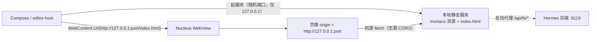
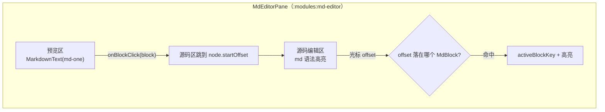

# 07 · 文件与编辑器

> 覆盖 `files` 域：**项目文件树 + 多类型预览 + 内嵌编辑器**。
> 所有文件内容**只通过 Hermes 的 `/api/fs/*` 读取**，客户端不直接访问磁盘（含远程模式）。
>
> **状态：调研记录，未选型（2026-11-16）。**
> 本篇记录「Nucleus WebView（`composewebview`）+ Monaco」这条调研线的形态与实测结论
> （S1–S4 已验，S5 体积未达目标）。**它不是产品决策** ——
> 与纯 Compose 预览器、`@codingame/monaco-vscode-api`、code-server、Kortex 等方向尚未做最终比较。
> 读到「必须」「已定」这类措辞时，按「本调研线内的结论」理解。
>
> 依据：[`00-功能域总览.md`](00-功能域总览.md)；调研记录：ADR-078（WebView 线）· ADR-079（对标开源）·
> **ADR-080（可抄清单总账）** · **ADR-081（Markdown 编辑方案）**；
> 契约：[`../../草案/08-data-contract.md`](../../草案/08-data-contract.md) §3.3（`/api/fs/*`）。

---

## 0. 一句话边界

| 做 | 不做 |
|---|---|
| 项目文件树（懒加载、只读浏览） | 文件重命名 / 删除 / 新建（写操作只做「保存已有文本文件」） |
| 代码高亮 + 只读预览 + 编辑保存 | LSP（补全 / 跳转 / 诊断） |
| 图片 / Markdown / PDF / HTML / 二进制预览 | git 集成（status / diff / commit） |
| 同一目录内两个文件的 diff 对比 | 多根工作区、搜索替换跨文件 |

> **为什么不接 LSP / git**：后端 `/api/` 全表里有 `/api/fs/*` 与 `/api/git/*`，但**没有任何 LSP 端点**。
> `agent/lsp/` 是给 agent 自己写文件后做诊断用的，不对外。接 LSP 只能在客户端自起 language server
> 并建立 HTTP→stdio 隧道，等于新增一层运维面；本期不做。

---

## 1. 这条调研线的技术形态

> **本方向尚未选型。** 本节只解释「这条线内部」怎么实现；横向比较与结论见 ADR-078。

### 1.0 宿主用哪个 WebView：Nucleus 官方的 `composewebview`

**这不是"第三方 WebView 库"**，是 Nucleus 自己的 WebView 能力，只是**独立仓库、独立版本号**：

| 事实 | 依据 |
|---|---|
| 官方文档站 `nucleusframework.dev/en/docs/webview` 明写 «The artifact is `dev.nucleusframework:composewebview`» | Nucleus 文档 |
| 源码仓库 [`NucleusFramework/ComposeNativeWebview`](https://github.com/NucleusFramework/ComposeNativeWebview)，与 Nucleus 同组织、同 `NativeView` 机制 | 仓库归属 |
| Nucleus 主线 `settings.gradle.kts`（3.0 分支）**没有** webview 模块 —— WebView 一直是"独立发版"，与 system tray / PDF reader 同类 | 我逐行核对过 103 个 `include` |
| Windows 上它内部就是 `WebView2 CompositionController` + Tao `NativeView`（源码类 `WindowsWebView2NativeWebView.asPlatformView()` 返回 `NucleusPlatformView$HWnd`） | 反编译核对 |

因此本域**不自己写 WebView2 controller**：宿主由 Nucleus 的 WebView 构件提供，
我们只在里面放自己的宿主页面（Monaco + `HermesFsProvider`）。

### 1.0.1 与 Nucleus 3.0 的兼容性（已用字节码核对，不是估计）

`composewebview 1.0.3` 的 POM 声明 `nucleus.decorated-window-tao 2.5.5`，而本项目用 `3.0.0-dev-*`。
用 `javap` 逐个符号核对后确认：**它只引用 4 个 tao 符号，3.0.0-dev 全部提供**。

| `composewebview 1.0.3` 引用的符号 | `3.0.0-dev-202611150604` |
|---|---|
| `NativeViewKt.NativeView-hGBTI10`（旧的 4 参重载） | ✅ 保留（3.0 另增了带 `boolean` 的 `-jIwJxvA`） |
| `DecoratedWindowKt.getLocalTaoWindow` | ✅ |
| `TaoWindow.getNativeHandle(): Long` | ✅ |
| `NucleusPlatformView$HWnd` + `getHwndHandle()` + `resize/setBounds/clearFocus/setCornerRadius/dispose` | ✅ 全部存在（`dispose` 等为 `default` 方法） |

所以风险从「链接期 `NoSuchMethodError`」降为「**运行期行为需实测**」（焦点、DPI、DComp 合成仍要跑）。
依赖冲突用 Gradle `resolutionStrategy` 强制到项目统一的 Nucleus 版本即可。

### 1.1 出发点：不自研编辑器 UI

纯 Compose 方案（`highlightCode` + 自绘文件树 + 自绘 diff）能跑，但**维护面全落在我们这边**：
语言覆盖（现 39+6 种）、diff 渲染、折叠、多光标、选区、命令面板，每一项都要长期跟。

`@codingame/monaco-vscode-api`（MIT，2026-11 仍在推送）把 VS Code 的**服务层**抽成可嵌入模块：
`IFileService` / `IFileSystemProvider` / explorer 视图 / Monaco 编辑器全部就位。
我们只需要实现一个 **文件系统 provider**（约 200–400 行），把它接到 `/api/fs/*`。

于是：文件树 UI、语法高亮、diff editor 全部由上游维护，我们只维护 provider 与桥。

### 1.2 这条线为什么排除「外部编辑器内嵌」

> 「排除」= 在「文件全走 `/api/fs/*`」这个前提下不成立；换前提需重新评估。

考察过 Zed（62.1 MB / GPL-3.0）、Lapce（19.7 MB / Apache-2.0）、Scintilla 自绘壳、
Aardink（Compose 原生）、code-server（MIT，服务端）。

否决理由集中在三条：

1. **远程文件对不齐**：Zed / Lapce 的远程能力是「SSH 到同一台机器并起自己的 server」，
   与本项目「后端已托管 workspace（`SshWorkspaceFs`）」是两套路径。要么用户在编辑器里再配一次 SSH，
   要么两套路径指向不同目录，git / 文件内容对不上。
2. **外壳不可控**：内嵌完整 IDE 必然带它的菜单 / 状态栏 / 快捷键；塞进窄 pane 观感最差，
   改「整窗模式」又与现有 rail + 三栏布局冲突。
3. **必须新增架构面**：内嵌外部程序的 Windows 原生窗口要 `NativeView` 的 DComp 覆盖层、
   要处理单实例抓窗口、DPI、提权、IME；而 WebView 是同一进程内的子控件，
   且 Nucleus 的 WebView 已经把这层封好了。

> `code-server` 仍然是最省事的备选（零 provider 代码），代价是额外跑一个 Node 服务（包约 187 MB）。
> 若将来这条路被证伪，优先回退到它。见 ADR-078「替代方案」。

### 1.3 体积与裁剪

不给 LSP 就不需要语言服务 worker，Monaco 的体积大头可以直接删：

| 组成 | min 后 | 保留 |
|---|---|---|
| `vs/editor-*.js`（编辑器主体） | 2.41 MB | ✅ |
| `vs/editor/editor.main.css` | 382 KB | ✅ |
| `vs/assets/editor.worker-*.js` | 269 KB | ✅（diff 计算与基础 worker） |
| `basic-languages/*`（90+ 语言着色） | 约 1 MB | ✅ |
| `ts.worker`（TypeScript 语言服务） | 6.87 MB | ❌ 删 |
| `css.worker` / `html.worker` / `json.worker` | 1.03 / 0.70 / 0.40 MB | ❌ 删 |

**目标增量 ≈ 3–4 MB**（含 `monaco-vscode-api` 用到的少量服务模块）。验收里钉死 ≤ 8 MB。

---

## 2. 数据源：只走 `/api/fs/*`

所有路径都是**后端视角的绝对路径**（local 模式=本机；remote 模式=SSH 目标机）。
客户端从不拼接本机路径，也从不读 `File`。

| 能力 | 端点 | 关键返回 |
|---|---|---|
| 列目录 | `GET /api/fs/list?path=&profile=` | `{entries:[{name, path, isDirectory}], error?}` |
| 读文本 | `GET /api/fs/read-text?path=&session_id=&profile=` | `{text, language, binary, byteSize, mimeType, truncated, path}` |
| 读图片（data URL） | `GET /api/fs/read-data-url?path=&profile=` | `{dataUrl}`；带 `ETag`，命中返回 **304** |
| 大文件流 | `GET\|HEAD /api/fs/stream`、`/api/fs/download` | `Content-Length` 可用于补 `size` |
| 保存文本 | `POST /api/fs/write-text` | `{ok, path, byteSize}`；上限 8 MiB |
| workspace 根 | `GET /api/fs/default-cwd?profile=` | `{…}` 默认浏览起点 |

### 2.1 三条必须处理的约定

1. **`/api/fs/list` 失败不抛 HTTP 错误**，是 `200 + {entries:[], error:"EACCES"}`。
   不处理就会表现成「空目录」。错误码要映射成可读提示（`ENOENT`/`EACCES`/`read-error`）。
2. **`read-text` 会截断**：`_FS_TEXT_PREVIEW_MAX_BYTES = 512 KiB` 之外返回 `truncated: true`。
   UI 必须显式提示「已截断，仅显示前 512 KiB」，不能让用户以为内容完整。
3. **`write-text` 没有版本比对**（后端注释：stale detection is the client's job）。
   保存前必须重新 `read-text` 一次比对内容，不一致就提示冲突、不覆盖。

### 2.2 隐藏与安全规则由后端负责，客户端不重复实现

后端已过滤：`.git` `.hg` `.svn` `.cache` `.next` `.turbo` `.venv` `__pycache__`
`build` `dist` `node_modules` `target` `venv`；敏感文件 `.env` / `.env.*` / `.envrc` /
`auth.json` / `credentials` / `mcp-tokens/` / `pairing/` 在**出列阶段**就被剔除。

客户端**不得**再写一套自己的忽略规则，否则两套规则会漂。

---

## 3. `stat` 与 `watch`：两条硬限制与我们的做法

### 3.1 `stat`：`mtime` 拿不到，一律补 0

`/api/fs/list` 只给 `{name, path, isDirectory}`，没有 `size` / `mtime`。
`/api/fs/download` 的 `Content-Length` 能补 `size`（远程分支注释写明「a HEAD reads none of it」），
但**没有任何端点提供 `mtime`**。

**决策**：`HermesFsProvider.stat()` 一律返回 `mtime = 0`、`ctime = 0`、`size = undefined`，
**不做逐条 HEAD**（展开一个 100 文件的目录会变成 100 个请求，远程链路不可接受）。

后果：

- explorer 不显示「修改时间」与「大小」两列 —— 这只是信息缺失，不影响功能；
- 任何依赖 `mtime` 做过期判断的逻辑（缓存、脏标记）**不能用**，改用「内容比对」或「版本计数」。

> 旁路：`/api/files`（managed files）**确实返回 `size` + `mtime` + `mime_type`，
> 但它只读本机、不走 SSH workspace，语义与 `/api/fs/*` 不同。**本域不使用它**。

### 3.2 `watch`：后端不存在，用「agent 工具事件」做启发式刷新（方案 3）

后端整个 `hermes_cli/` 里没有任何文件系统监听（`watchdog` / `inotify` / `fsnotify` 全部命中无关的
进程看门狗）；WebSocket 端点全表里也没有文件通道：

```
/api/audio/speak-stream  /api/audio/transcribe-stream  /api/console
/api/display/ws  /api/events  /api/host-terminal  /api/pty  /api/pub  /api/ws
```

`/api/events` 是**会话事件**广播，只承载 `message` / `tool_use` / `tool_result` / `session` / `browser`
这类事件，**没有 `file_changed`**。契约只读，我们不能新增 `/api/fs/watch`。

**决策（方案 3）**：监听现有 JSON-RPC 事件流里的工具调用，命中「写文件类工具」时按路径失效缓存并刷新对应目录。

| 项 | 内容 |
|---|---|
| 触发源 | `event` 通知里 `type = tool_use`（及 `tool_result` 失败回滚） |
| 过滤 | 工具名 ∈ `{write_file, read_file, patch, apply_patch, edit_file, str_replace}` 等写/改类 |
| 路径抽取 | 复用已有 [`ToolFilePaths.kt`](../../../composeApp/src/commonMain/kotlin/dev/shinglem/hermes/feature/editors/ToolFilePaths.kt) 的解析逻辑（`path` 字段、相对路径按 cwd 解析、`~/` 展开） |
| 动作 | 该路径所在目录 → 标脏 → 若当前展开则重拉 `/api/fs/list`；若该文件正开着 → 重拉 `read-text` |
| 去抖 | 300 ms（一次 patch 可能连发多条事件） |

**已知覆盖缺口**（必须写进 UI 说明）：

- 用户在外部编辑器 / 资源管理器里改的文件**不会**触发刷新；
- agent 通过终端命令（`mv` / `rm` / `git checkout`）改的文件**不会**触发（工具名不是写文件类）；
- 因此**必须**同时提供「手动刷新」按钮（文件树标题栏），并在面板失焦再获得焦点时（可配置）做一次轻量重拉。

### 3.3 不做轮询

`/api/fs/list` 在远程模式下每次都是 SSH 往返；对展开的每个目录做 3–5 秒轮询会让链路持续饱和。
**明确不做常驻轮询**；只在用户显式刷新、agent 事件命中、面板重新获得焦点这三种时机拉取。

---

## 4. 状态字段

```kotlin
// feature/files/FilesState.kt
data class FilesState(
    val scope: FileScope,                    // 见下
    val tree: FileTreeState,
    val tabs: List<EditorTab>,
    val activeTabId: String?,
    val preview: PreviewState,               // 非编辑器类型走这里
    val refreshing: Boolean,
    val error: String?,                      // 列表/读取失败的统一出口
)

/** 浏览与编辑的根：由 /api/fs/default-cwd 或会话 cwd 决定 */
data class FileScope(val profile: String?, val rootPath: String?, val sessionId: String?)

data class FileTreeState(
    val root: TreeNode?,                     // 懒加载：children 为 null 表示未展开
    val expanded: Set<String>,               // 绝对路径
    val selected: String?,
    val loading: Set<String>,                // 正在拉取的目录
    val failed: Map<String, String>,         // 目录路径 → 错误码
)

data class TreeNode(
    val name: String,
    val path: String,
    val isDirectory: Boolean,
    val children: List<TreeNode>? = null,    // null = 未加载
)

data class EditorTab(
    val path: String,
    val language: String,                    // 直接来自 read-text 的 language 字段
    val text: String,
    val byteSize: Int,
    val truncated: Boolean,
    val binary: Boolean,
    val dirty: Boolean,
    val readOnly: Boolean,
    val loadState: Loadable<Unit>,
)

sealed interface PreviewState {
    data object Empty : PreviewState
    data class Image(val path: String, val mimeType: String) : PreviewState
    data class Markdown(val path: String, val text: String) : PreviewState
    data class Pdf(val path: String) : PreviewState
    data class Unsupported(val path: String, val mimeType: String, val byteSize: Int) : PreviewState
}
```

标签页与树状态**挂在 `AppContainer`**（与终端一致），切模式、切会话不丢；`FileScope` 变化时清空重来。

---

## 5. 组件树

```
FilesPane                          // 一个整窗模式面板（见 §6 布局）
├── FileTreePane                   // 左：树
│   ├── FileTreeHeader             // 根路径 + 刷新按钮 + 折叠全部
│   ├── FileTreeList               // LazyColumn（注意：不要嵌套 LazyColumn，见硬约束 5）
│   │   └── FileTreeRow            // 缩进 + 图标 + 名称 + 加载/错误指示
│   └── FileTreeEmpty              // 空态 / 错误态
└── FileContentPane                // 右：内容
    ├── EditorTabBar               // 多标签，脏标记点
    ├── CodeEditorHost             // Nucleus WebView 槽位（内部 = Tao NativeView + WebView2）
    │   └── WebView(state) ── Monaco / monaco-vscode-api
    ├── MarkdownPreview            // 复用 :modules:markdown-one 的 MarkdownText
    ├── ImagePreview               // Coil 解码 read-data-url 的 ByteArray
    ├── PdfPreview                 // PDFBox 渲染页 → Image
    └── UnsupportedCard            // 类型/大小 +「用系统默认程序打开」
```

**硬约束不变**：外层 `LazyColumn` 内不得再嵌 `LazyColumn`；文件树自身是唯一的滚动容器，
预览区不与它共用滚动。代码编辑区（Nucleus WebView，内部是 `NativeView` 子视图）**必须是独立 pane**，
不能塞进消息流。

---

## 6. 布局与模式

沿用 ADR-009 的左侧 rail 与「整窗模式」思路：

| 模式 | 布局 |
|---|---|
| 会话模式 | rail │ 会话列表 │ 聊天详情（现状不变） |
| **文件模式** | rail │ 文件树（240–360 dp，可拖拽）│ 内容区（剩余宽度） |

- rail 上的入口图标放在「会话 / 能力」之外，作为第三个模式按钮；
- 窄窗（`width < 840 dp`）退化为单栏：先进树，点文件后进内容区，返回键回树；
- 文件树宽度与展开态持久化到 `ui.filesLayout`（仿 `ui.terminalLayout`）。

---

## 7. `HermesFsProvider` 契约（JS 侧）

`monaco-vscode-api` 要求实现 `IFileSystemProvider`。我们的实现要点：

```javascript
// 伪代码：仅示意形状，实际类型见 @codingame/monaco-vscode-files-service-override
class HermesFsProvider {
  capabilities = { fileReadWrite: true, fileFolderCopy: false, pathCaseSensitive: false }

  // ⚠️ 后端没有 mtime：一律 0，size 一律 undefined
  async stat(uri) {
    const parent = dirname(uri.path)
    const { entries, error } = await hermes.listDir(parent)
    if (error) throw toFsError(error)
    const e = entries.find(x => x.name === basename(uri.path))
    if (!e) throw new FileSystemError(FileSystemError.FileNotFound(uri))
    return { type: e.isDirectory ? FileType.Directory : FileType.File,
             mtime: 0, ctime: 0, size: undefined }
  }

  async readdir(uri) {
    const { entries, error } = await hermes.listDir(uri.path)
    if (error) throw toFsError(error)               // ← 必须抛，否则表现为空目录
    return entries.map(e => [e.name, e.isDirectory ? FileType.Directory : FileType.File])
  }

  async readFile(uri) {
    const r = await hermes.readText(uri.path)
    if (r.binary) throw new FileSystemError(FileSystemError.FileIsBinaryFile(uri))
    return new TextEncoder().encode(r.text)         // 注意 truncated 只影响展示
  }

  async writeFile(uri, bytes) {
    const current = await hermes.readText(uri.path)  // 保存前重读比对（防覆盖）
    if (current.text !== lastReadText(uri)) throw new FileSystemError(FileSystemError.FileModifiedSince)
    await hermes.writeText(uri.path, new TextDecoder().decode(bytes))
  }

  watch(uri) {
    // 后端无文件监听：no-op。刷新由 agent 工具事件 + 手动刷新驱动（§3.2）
    return { dispose() {} }
  }
}
```

URI scheme **不能用 `file:`**（否则 Monaco 会走自己的本地 provider）：
统一映射为 `hermes-fs:/<windows-or-posix-absolute-path>`，由 provider 负责与后端路径互转。

### 7.1 宿主页面怎么加载：**必须走本地 http 真源**（已实测）

Monaco 的 worker 受同源限制。Nucleus WebView 提供三种入口
（`WebContent.Url` / `.Data` / `.File`，见官方 [API reference](https://nucleusframework.dev/en/docs/webview/api-reference)），
**三轮探针实测结论如下**（`./gradlew :composeApp:webViewProbe`，结果写 `composeApp/build/webview-probe.txt`）：

| 入口 | 源的实际情况 | fetch 到后端 | `new Worker(http:)` | blob worker | 结论 |
|---|---|---|---|---|---|
| `WebContent.Data`（无 baseUrl） | `data:`，`origin = null` | ❌ `TypeError: Failed to fetch` | ❌ `cannot be accessed from origin 'null'` | ✅ 可用 | 只能跑「单文件、不需要后端」的场景 |
| `WebContent.Data` + `baseUrl = "https://app.local/"` | **`baseUrl` 被忽略**，仍是 `data:` | ❌ | ❌ | ✅ | **不可用**（`navigator.loadHtml(baseUrl=…)` 未生效） |
| `WebContent.File(COMPOSE_RESOURCE_FILES)` | `file:` | ❌（跨源） | ❌（`file:` 下 worker 被禁） | — | 不可用 |
| **`WebContent.Url("http://127.0.0.1:<port>/index.html")`** | **真源 `http://127.0.0.1:<port>`** | ✅ `ok` | ✅ | ✅ | **唯一可行**（复测：8 个并发 blob worker 全部 `ok`） |

实测细节（第二轮）：

```text
[js-data] origin=null proto=data:  scriptTag=loaded   fetchCross=fail:TypeError:Failed to fetch
          workerHttp=throw:Failed to construct 'Worker': Script at 'http://127.0.0.1:55569/x.js'
                     cannot be accessed from origin 'null'.
          workerBlob=ok:pong
[js-http] origin=http://127.0.0.1:55569 proto=http:  fetchSame=ok:{"ok":true}
          workerBlob=ok:pong  scriptSame=loaded
```

顺带两个数据点：

1. **`classic <script src="http://…">` 在 `data:` 源下能加载**（不受 CORS 限制），
   但 `fetch` 与 `new Worker(httpUrl)` 都被拦 —— 所以「用脚本标签绕 CORS」不成立（Monaco 需要 `fetch`）。
2. **`navigator.loadHtml` 不可靠**：第三轮连续三次 `loadHtml`（1 / 2 / 3 MB）全部
   `loadingState=Finished` 且 `lastLoadedUrl` 停在 `about:blank`、页面脚本一次都没执行；
   但后来单独一次 `loadHtml`（1 MB，且此前先加载过 http 页面）**又确实生效了**（页面正常上报）。
   结论：`loadHtml` 的行为**依赖上下文、不可依赖**，不能作为宿主页方案。
   `rememberWebViewStateWithHTMLData`（首帧就带 HTML）则一直可靠。

**因此宿主页方案改为：本地 http 真源 + 虚拟主机映射不再需要**

`composewebview` 的公开 API **没有** `SetVirtualHostNameToFolderMapping`
（`PlatformWebSettings.DesktopWebSettings` 只有 `transparent` / `dataDirectory` / **`initScript`** /
`enableClipboard` / `enableDevtools` / `enableNavigationGestures` / `incognito` /
`autoplayWithoutUserInteraction` / `focused`；`NativeWebView` 只有
`loadUrl / loadHtml / evaluateJavaScript / addNavigateListener / openDevTools / captureScreenshotNative / drainIpcMessages`）。
**但它根本不需要** —— 我们只要自己起一个 loopback HTTP 服务：



具体规格：

| 项 | 决定 |
|---|---|
| 服务 | **Ktor server CIO**（项目已依赖 Ktor；不引入新框架），只绑 `127.0.0.1`，端口 `0` 由 OS 分配 |
| 静态资源 | Monaco 裁剪后的 `vs/` 目录 + 我们自己的 `index.html`，从 jar 资源解到临时目录（或直接流式返回） |
| `/api/fs/*` | **两种做法二选一**：① 服务端反向代理到后端（带上 token），页面只与本地服务同源；② 页面直接 `fetch` 到后端 —— 需要后端 CORS 放行我们的源 |
| 生命周期 | 与 `FileScope` 同寿命；面板关闭即停服务（避免常驻监听端口） |
| 安全 | 只绑 loopback + 每次启动随机端口 + 随机路径前缀 token（同官方 `--remote-debugging-port=0` 思路） |

**为什么不用 ②（直接 fetch 后端）**：后端 CORS 是白名单制 ——
`web_server.py` 用 `_LocalOriginCORSMiddleware`，只放行
`state.bound_port` 自己的源、`dashboard.public_url` 的源、以及 `HERMES_DESKTOP_DEV_SERVER`
指向的源（见 `web_server_boundary.is_trusted_local_origin`）。
我们自己的 `http://127.0.0.1:<随机端口>` **不在白名单里**，直接 fetch 会 401/被拦。
不改后端（契约只读）就只能用 ①**反向代理**。

> ① 的额外好处：token 只留在 Kotlin 侧，页面永远拿不到 token；页面的所有请求都同源。

### 7.2 `index.html` 需要什么

Monaco 在 `http://127.0.0.1:<port>` 真源下，`new Worker('/vs/assets/editor.worker-*.js')`
与 `new Worker(new URL(...))` 都可正常工作（第三轮 8 并发 blob worker 全 ok）。
建议把 worker 也走**同源静态路径**而不是 blob（便于 DevTools 调试），
blob 作为降级手段保留。

`DesktopWebSettings.initScript` 可用来在页面加载前注入 `window.__hermesBridge = { port, token }` 之类的引导信息。

---

## 8. 方法签名（Compose 侧门面）

```kotlin
// composeApp 只看到这个门面；Monaco/WebView 细节都在 :modules:editor-host 内
@Composable
fun CodeEditorHost(
    text: String,
    language: String,
    readOnly: Boolean,
    modifier: Modifier = Modifier,
    onTextChange: (String) -> Unit,
    onSaveRequested: () -> Unit,
    onCursorChange: (line: Int, column: Int) -> Unit = { _, _ -> },
    diff: EditorDiff? = null,        // 非 null 时切到 createDiffEditor
)

data class EditorDiff(val originalText: String, val modifiedText: String, val language: String)
```

### 8.1 桥怎么接（用 Nucleus WebView 自带的 JS bridge，不自己造）

`composewebview` 已经提供 `WebViewJsBridge` + `IJsMessageHandler`，页面侧是
`window.kmpJsBridge.callNative(methodName, params, callback)`。**直接用它，不另造一套 `window.hermes.*`**：

```kotlin
val navigator = rememberWebViewNavigator()
val bridge = rememberWebViewJsBridge(navigator)

LaunchedEffect(bridge) {
    bridge.register(object : IJsMessageHandler {
        override fun methodName() = "editorEvent"
        override fun handle(message: JsMessage, navigator: WebViewNavigator?, callback: (String) -> Unit) {
            // message.params 是 JSON：{"type":"changed"|"ready"|"save"|"cursor"|"error", ...}
            callback("""{"ok":true}""")
        }
    })
}

WebView(
    state = rememberWebViewState("https://app.local/index.html"),
    navigator = navigator,
    webViewJsBridge = bridge,
    onCreated = { native -> /* 仅用于打点/devtools */ },
    modifier = Modifier.fillMaxSize(),
)
```

| 方向 | 机制 | 消息 |
|---|---|---|
| Kotlin → JS | `navigator.evaluateJavaScript(script)` | `setText` / `setLanguage` / `setReadOnly` / `showDiff` / `focus`（幂等，可重复下发） |
| JS → Kotlin | `kmpJsBridge.callNative("editorEvent", json, cb)` | `ready` / `changed{text}` / `dirty{bool}` / `cursor{line,col}` / `save` / `error{code,message}` |

注意：`evaluateJavaScript` 是**字符串脚本**，参数要做 JSON 转义（不要拼裸文本）。
`changed` 做 150 ms 去抖后回传，避免逐键穿越 WebView 边界。

---

## 9. 非编辑器类型的预览

| 类型 | 判定 | 渲染 | 依赖 |
|---|---|---|---|
| 代码 / 纯文本 | `language != "text"` 或扩展名命中 | Monaco（只读或可编辑） | 无 |
| Markdown | `.md` / `language == "markdown"` | `MarkdownText`（可切「源码」= Monaco） | 无 |
| 图片 | mimeType `image/*` | `read-data-url` → Coil 解码 ByteArray；缩放/平移 | 无（markdown-one 已带 Coil 3） |
| PDF | `.pdf` | PDFBox 渲染首页（按需翻页）→ Compose `Image` | **`org.apache.pdfbox:pdfbox` 3.0.8** |
| HTML | `.html` / `.htm` | `HtmlNativeAdapter`（ksoup 白名单，脚本丢弃） | 无 |
| 二进制 | `read-text` 的 `binary = true` | 类型 / 大小 / 前 64 字节 hex | 无 |
| 其他 | 兜底 | `UnsupportedCard` +「用系统默认程序打开」 | 无 |

**PDF 是唯一的重量级新依赖**（约 5 MB）。第一期可先只显示「PDF 不支持预览」+ 打开外部程序，
把 PDFBox 放到第二期。

### 9.1 diff 对比（`EditorDiff`）

两个来源：

1. **同目录两文件对比**：用户在树里多选两个文件 → 各自 `read-text` → `createDiffEditor`；
2. **文件当前内容 vs `read-text` 快照**：用于「编辑后查看改动」。

> `git diff` 不做：`/api/git/*` 虽然有 `review/diff`，但本域明确不接 git。

---

## 10. 空 / 错 / 载入态

| 场景 | 表现 |
|---|---|
| 树根未确定（`default-cwd` 失败） | 空态 +「重试」+ 显示错误码 |
| 目录拉取失败（`error` 字段） | 该行右侧出现 `!` 图标，展开时显示错误码文本，**不伪装成空目录** |
| 文件读取中 | 内容区骨架 + 标签页标题转圈 |
| `binary = true` | 不尝试渲染，直接二进制卡片 |
| `truncated = true` | 内容区顶部黄色横幅「已截断，仅显示前 512 KiB」 |
| 保存失败 | Snackbar + 保留编辑内容 +「重试保存」 |
| 保存冲突（内容已变） | 对话框：「磁盘内容已变化」→ 覆盖 / 放弃 / 另存 |
| WebView 未就绪 | `loadingState` 非 `Finished` 时显示骨架；超时（10s）显示「编辑器加载失败」+ 重载按钮 |
| WebView2 Runtime 缺失 | 整域降级：只提供树 + 系统默认程序打开（与 v0.6.1 的检测逻辑复用） |

---

## 11. 实施步骤与 spike 判据

### 11.1 必须按顺序验证的前置

**S1 / S2 已实测通过**（2026-11-16，`./gradlew :composeApp:webViewProbe`，结果 `composeApp/build/webview-probe.txt`）：

| # | 判据 | 状态 |
|---|---|---|
| **S1** | **宿主页必须走本地 http 真源**。实测：`data:` 源（`origin=null`）下 `fetch` 失败、`new Worker(http)` 抛异常；`http://127.0.0.1:<port>` 真源下 fetch / blob worker / classic script **全部正常**，8 个并发 blob worker 全 `ok`。`navigator.loadHtml` 行为依赖上下文、不可靠 | ✅ **通过**：自起 loopback 静态服务（Ktor CIO，端口 0），见 §7.1 |
| **S2** | `composewebview 1.0.3` 与 Nucleus `3.0.0-dev` **运行期共存**：窗口能开、WebView 能显示、无 `NoSuchMethodError`；JS 桥正常注入并可回传 | ✅ **通过** |
| **S3** | **真实 Monaco 在 loopback 真源下可用**：91 种语言注册（含 kotlin）、`colorize` 出 26 个 span、`editor.worker` 可构造 | ✅ **通过**（`webViewProbe3`） |
| **S4** | **`createDiffEditor` 正常**：改动 2 行 → `getLineChanges()` 返回 1 条 | ✅ **通过** |
| S5 | 体积增量 ≤ 8 MB | ❌ **未达**：Monaco `min/vs` 完整集 **24.38 MB** / 138 文件（见下方实测） |

**S3 的范围修正（重要）**：纯 `monaco-editor` **没有** explorer / `IFileSystemProvider` ——
`monaco.FileType` 不存在，`stat` / `readdir` 那层是 `@codingame/monaco-vscode-api` 才提供的。
所以「文件树 UI 由 Monaco 提供」这个设想需要 `monaco-vscode-api`（体积与集成复杂度都会上一档）；
若只用 `monaco-editor`，**文件树必须自己用 Compose 画**。

**S5 实测（关键约束）**：Monaco 的 `min/vs` 不能按文件随意裁剪 —— `vs/editor/editor.main.js`
是 AMD 模块，`define(...)` 里硬依赖 `../json.worker-*` / `../css.worker-*` / `../html.worker-*` /
`../ts.worker-*` 以及 `toggleHighContrast-*.js`。**删任何一个都会让 `editor.main` 加载失败**
（实测三次都撞到 `require(editor.main) 失败: [object Event]`）。

| 裁剪尝试 | 结果 |
|---|---|
| 删 4 个语言服务 worker（ts 6.87 MB / css 1.03 / html 0.70 / json 0.40）+ `vs/language/{typescript,css,html,json}` | ❌ `editor.main` 加载失败 |
| 再删 `toggleHighContrast-*.js`（1.24 MB） | ❌ 同样失败 |
| 删 `vs/nls/lang/` 下非中文语言包（2.51 MB → 176 KB） | ✅ 可用（非中文语言包可安全删除） |

**因此体积现实**：
- **22.04 MB**（126 文件）= 完整集 24.38 MB − 非中文语言包 2.34 MB，**这是最小的可用集**；
- 要再小只能改 `editor.main.js` 的 `define` 依赖列表（手工剥 AMD 依赖），维护成本高、上游一升级就失效；
- 若改走 `@codingame/monaco-vscode-api`，它是 ESM 打包，可按需导入，体积能压到 5–10 MB —— 但那是另一套集成方式。

S1 的连带结论（都已在探针里撞到过，实现时直接用）：

- **`WebContent.Data` / `loadHtml` 这条路直接放弃** —— 实测已判死；
- **不需要虚拟主机映射**（也不需要自建 WebView2 controller）：本地 http 服务本身就是真源；
- **不能直接 `fetch` 后端**：后端 CORS 是白名单制（`_LocalOriginCORSMiddleware` 只放行自己端口 /
  `dashboard.public_url` / `HERMES_DESKTOP_DEV_SERVER`），我们的随机端口不在里面 → 必须**反向代理**。

### 11.1.1 体积结论对方案的影响（必须决策）

S5 未达 8 MB 目标，而 Monaco 的 AMD 依赖链使得「按文件裁剪」不可行。三个选项：

| 选项 | 体积 | 代价 |
|---|---|---|
| **A. 接受 22 MB** | 22.04 MB（最小可用 AMD 集） | 发布包 +22 MB；实现最简单，上游一升级即跟随 |
| **B. 手剥 `editor.main.js` 的 `define` 依赖** | 理论可到 ~12 MB（去 4 个语言服务 + 高对比度） | 每次升级 Monaco 都要重做；一旦漏依赖就是白屏 |
| **C. 改用 `@codingame/monaco-vscode-api`（ESM）** | 5–10 MB（按需导入） | 集成方式完全不同；**但它是唯一同时提供 explorer / `IFileSystemProvider` 的方案** |

**C 同时解决 S3 的范围问题**（纯 `monaco-editor` 没有文件树）。如果目标形态是「文件树 + 编辑器 + diff 全交给上游」，那 C 是唯一选择；若接受「文件树自己用 Compose 画」，A 够用。

> 本条留作待决策，不阻塞 P1（loopback 服务与 provider 封装与 A/C 都无关）。

### 11.2 分阶段落地

| 阶段 | 内容 | 产出 |
|---|---|---|
| P0（spike） | ✅ S1–S4 已完成。剩余：Monaco 体积方案 A/B/C 的取舍决策 | 已可运行 |
| P1 | `:modules:editor-host` 的 loopback 服务（Ktor CIO + 静态资源 + 反向代理 + 随机 token） | 可持续运行的宿主 |
| P2 | `:modules:fs-provider`：`/api/fs/*` 的 Kotlin 封装（DTO + Repository + 错误映射）与单测；`HermesFsProvider`（JS）+ 桥 + `CodeEditorHost` 门面 | 代码能看、能保存 |
| P3 | 文件树（Compose 自绘或 monaco-vscode-api，取决于 11.1.1）；图片 / Markdown / HTML / 二进制预览；手动刷新 + agent 事件刷新 | 常用类型覆盖 |
| P4 | PDF（PDFBox）；多标签；布局持久化 | 完整域 |

---

## 12. 验收条目

| # | 条目 | 方式 |
|---|---|---|
| F1 | local 模式下能浏览会话 cwd，展开三层目录 | 手测 |
| F2 | remote 模式下同一套代码能浏览 SSH workspace（不出现本机路径） | 手测（需 SSH profile） |
| F3 | `.git` / `node_modules` / `.env` 不出现 | 手测 |
| F4 | 目录无权限时显示错误码，不显示为空目录 | 手测 + 单测（DTO 映射） |
| F5 | 打开 `.kt` / `.py` / `.json` 高亮正确，行号连续 | 手测 |
| F6 | 超过 512 KiB 的文件显示截断横幅 | 单测 + 手测 |
| F7 | 编辑并保存后重新打开内容一致；冲突时弹对话框 | 手测 |
| F8 | agent 用 `write_file` 改当前打开的文件 → 3 秒内内容自动刷新 | 手测 |
| F9 | 手动刷新按钮在 agent 用终端改文件后能同步 | 手测 |
| F10 | 图片 / Markdown / HTML / 二进制四类预览正确 | 手测 |
| F11 | diff 两文件并排显示，增删行着色正确 | 手测 |
| F12 | 窗口 resize、DPI 150%/200% 下 WebView 内容不错位 | 手测（RDP + 本机） |
| F13 | 提权进程下正常工作 | 手测 |
| F14 | 发布包增量 ≤ 8 MB | CI 对比产物大小 |

---

## 13. 坑（写下来避免重踩）

1. **`data:` 源是陷阱**：`origin=null` 下 `fetch` 与 `new Worker(http)` 都被拦，只有 blob worker 能用。
   **必须自起 loopback http 服务**当宿主（§7.1），不要在这上面再花时间。
2. **`loadHtml` 不可依赖**：`baseUrl` 参数不生效（`origin` 仍是 `null`），且同一份 HTML
   三次不导航、一次生效 —— 行为依赖上下文。宿主页一律用 `WebContent.Url` / `rememberWebViewState(url)`。
3. **后端 CORS 是白名单制**：`_LocalOriginCORSMiddleware` 只放行自己的 bound_port /
   `dashboard.public_url` / `HERMES_DESKTOP_DEV_SERVER`。我们的随机端口不在内 →
   页面**不能直接 fetch 后端**，必须由本地服务反向代理。
4. **URI scheme 不能是 `file:`**：`monaco-vscode-api` 会把 `file:` 交给内置本地 provider，
   于是它去读**本机**磁盘 —— 远程模式直接读不到，本机模式则绕过所有后端安全检查。
5. **`/api/fs/list` 的错误是 200**：不检查 `error` 字段 = 用户看到空目录 = 报「目录里没文件」的假 bug。
6. **`mtime = 0` 的连带影响**：Monaco 内部有基于 `mtime` 的缓存判断，全 0 会让它**每次都重新读**。
   对我们反而安全（不会用到陈旧内容），但要在 `readFile` 里自己做一层短期缓存（同一路径 2 秒内复用）。
7. **`write-text` 每次都是整体覆盖**：不是增量 patch，大文件保存要提示耗时。
8. **`read-text` 返回的 `language` 可直接喂 Monaco**：不要自己写扩展名映射，两套必然漂移。
9. **不嵌套 `LazyColumn`**（硬约束 5）：文件树与内容区是兄弟，不是父子滚动。
10. **不要为 Monaco 在 `composeApp` 里加 Compose 依赖**：它只活在 `:modules:editor-host` 的 WebView 里。
11. **WebView 的键盘焦点**：点进编辑器后 Compose 的全局快捷键（如 `Ctrl+K`）会先到 WebView；
    需要在桥里拦截并回抛给 Compose（或明确接受被编辑器吃掉）。
12. **本地服务只绑 loopback + 随机端口 + 随机路径前缀**：不要绑 `0.0.0.0`，
    也不要固定端口（同官方 `--remote-debugging-port=0` 的思路）。

---

## 14. 另一条调研线：对标 auto-dev 自研（`XiuperFileSystem` + diff）

> 与 §1–§13 的 WebView 线**并列的候选**：不用 WebView、不用 Monaco，纯 Compose 自研编辑器，
> 但**照抄 [`phodal/auto-dev`](https://github.com/phodal/auto-dev) 的两个成熟实现**。
> 调研记录见 ADR-079。

### 14.1 为什么看它

auto-dev 3.0（Xiuper）是一个 Kotlin Multiplatform 的 AI 开发平台，**11 万+ 行**
（`mpp-ui` 464 文件 / 90,098 行，`xiuper-fs` 53 / 5,510，`xiuper-ui` 79 / 16,314，`mpp-viewer` 5 / 264）。
它和我们面对的是**同一类问题**（文件浏览 + 代码展示 + diff + 终端 + agent 协作），
其中两块与我们要做的几乎一一对应。

### 14.2 可借鉴点 ①：`XiuperFileSystem` 的接口设计（5,510 行）

```kotlin
// xiuper-fs/src/commonMain/.../XiuperFileSystem.kt（163 行）
interface XiuperFileSystem {
    suspend fun stat(path: FsPath): FsStat
    suspend fun list(path: FsPath): List<FsEntry>
    suspend fun read(path: FsPath, options: ReadOptions = ReadOptions()): ReadResult
    suspend fun write(path: FsPath, content: ByteArray, options: WriteOptions = WriteOptions()): WriteResult
    suspend fun delete(path: FsPath)
    suspend fun mkdir(path: FsPath)
    suspend fun commit(path: FsPath): WriteResult = WriteResult(ok = true)
}
```

与我们的 `/api/fs/*` 对照：

| 我们的端点 | 它的抽象 | 备注 |
|---|---|---|
| `GET /api/fs/list` | `list(path): List<FsEntry>` | `FsEntry` 是 sealed：`File(size?, mime?, modifiedAt?)` / `Directory` / `Special(kind)` |
| `GET /api/fs/read-text` | `read(path, ReadOptions(preferText = true))` | `ReadResult(bytes, contentType)`，有 `textOrNull()` |
| `POST /api/fs/write-text` | `write(path, bytes, WriteOptions(commitMode = Direct\|OnClose\|OnExplicitCommit))` | 它的 `commitMode` 对应我们「整体覆盖」的语义 |
| `list` 的 `error` 字段 | `FsException(FsErrorCode.ENOENT / EACCES / EIO / ENOTDIR …)` | 9 个错误码，比我们的字符串 `error` 规范化得多 |
| 多 profile / local vs remote | `XiuperVfs(mounts: List<Mount>)`：**多后端挂载**（`MemoryFsBackend` / `DbFsBackend` / `GitHubFsBackend` / **`RestFsBackend`** / `McpBackend`） | 我们的 local/remote 天然就是两个 mount |

**两个特别有价值的细节**：

1. **`FsStat.size` / `mime` / `modifiedAt` 全是 nullable** —— 印证「文件系统元数据不完整」是常态，
   我们「`mtime` 拿不到就补 null/0」不是特例。
2. **`RestFsBackend`（486 行）就是一个 HTTP 文件系统后端**：Ktor 发 REST、`RestSchema` 做路径→URL 映射、
   `FsErrorCode` 做错误映射。**它与我们 `/api/fs/*` 的适配层是同构的**，
   可作为 `HermesFsBackend` 的实现参照（照形状重写，不复制代码）。

**它的短板（正好是我们已解决的）**：`FsRepository` 的 `observeDir()` / `observeText()` 只有
**手动 `refreshDir()`**，全仓库搜 `WatchService` / `FileSystemWatcher` / `inotify` **零命中**。
→ 与我们的**方案 3（agent 工具事件启发式刷新）+ 手动刷新**是同一个答案。

### 14.3 可借鉴点 ②：diff 算法（自实现 LCS，约 1,245 行 + 4 个测试）

```
mpp-core/src/commonMain/kotlin/cc/unitmesh/agent/diff/
├── DiffModels.kt              347 行
├── DiffUtils.kt               232 行   ← LCS 逐行 diff，注释「Ported from AutoDev IDEA's StreamDiff」
├── DiffProvider.kt            144 行
├── DiffFormatter.kt           223 行
└── DiffContextCompressor.kt   299 行
（+ DiffParserTest / GitDiffFormatTest / DiffContextCompressorTest 三个测试）
```

`DiffUtils` 不依赖第三方，纯 Kotlin，产出 `DiffLine { Same | Added | Deleted }`。
若我们走自研路线且需要 diff，这套是现成的参照（**注意许可是 MPL-2.0，见 14.5**）。

### 14.4 可借鉴点 ③：UI 布局（1,285 行）

| 文件 | 行数 | 作用 |
|---|---|---|
| `agent/codereview/diff/DiffFileTreeView.kt` | 510 | **文件树**（左侧） |
| `agent/codereview/diff/DiffCenterView.kt` | 775 | **diff 双栏**（`LazyColumn` + 行级着色） |
| `base/VerticalResizableSplitPane.kt` | — | 可拖拽分隔条 |

注意：它们**都不是编辑器**（`DiffCenterView` 是只读 `Text` 渲染）；
`DevInEditorInput.kt`（958 行）是**聊天输入框**（`BasicTextField` + DevIn 语法高亮 + `@` 补全），
不是代码文件编辑器。**auto-dev 里没有我们想要的「代码编辑器」** —— 这块仍需自研。

### 14.5 许可与体积约束（决定性）

| 项 | 事实 | 影响 |
|---|---|---|
| 许可 | **MPL-2.0**（弱 copyleft，**文件级**） | ① 整仓 fork → 大量文件修改 → 都要按 MPL 开源；② **复制单个文件也要保留该文件的 MPL**；③ 只借「接口形状 / 架构思路」重写实现**不受限制**（思想与接口不受版权保护） |
| 体积 | 11 万+ 行 | 我们要的部分（`xiuper-fs` 5.5k + diff 1.2k）只占 **6%**，其余 94% 是 agent 平台（LLM 客户端、MCP、TreeSitter、多宿主打包） |
| 耦合 | `mpp-ui` 的编辑器依赖 `mpp-core` 的 `CompletionManager` / `McpClientManager` / `LLMService` / `ConfigManager` / `WorkspaceManager` | 抽一个组件要连带抽 6 个子系统 |
| 版本基线 | `kotlin 2.3.20` / `compose 1.11.1` / `jvmToolchain(17)` | 本项目 `2.4.21` / `1.12.2` / JVM 25 |
| 上游状态 | 3.0 **Alpha**，`master` 持续大改 | fork 会越走越远 |

### 14.6 结论：**不自研时照抄实现，也作为一个模块纳入候选**

可行路径（按推荐度）：

| 路径 | 做法 | 许可风险 |
|---|---|---|
| **A. 照接口重写**（首选） | 按 `XiuperFileSystem` 的形状设计我们的 `HermesFileSystem`（`stat/list/read/write` + `FsErrorCode` 枚举 + `Mount` 概念），实现指向 `/api/fs/*` | **无**（接口/思路不受保护） |
| **B. 单个文件引用** | 直接引用 `DiffUtils.kt`（232 行，独立无依赖） | 需保留 MPL 声明；后续修改该文件要开源 |
| **C. 整仓 fork 精简** | ❌ **不做**：11 万行、94% 无关、MPL 传染、深度耦合、Alpha |

> **「作为一个模块」的具体形态**：把 A 的产物做成 `:modules:files`（类比 `:modules:terminal`），
> 对外只暴露 `HermesFileSystem`（`stat/list/read/write`）与 `DiffEngine`（`diff(old, new): List<DiffLine>`）；
> 与 WebView 线的 `HermesFsProvider`（§7）**共用同一份 Kotlin 侧 Repository** ——
> 两条线在「数据层」是可以合流的，只在「渲染层」分叉。

### 14.7 两条调研线的对照

| | WebView + Monaco（§1–§13） | 自研 + 对标开源（本节） |
|---|---|---|
| 体积 | Monaco 22 MB（最小可用 AMD 集） | ~0（复用 `markdown-one` 的高亮 + 自绘） |
| 文件树 | 需 `monaco-vscode-api`，否则自己画 | 自己画（参照 `DiffFileTreeView`） |
| 代码高亮 | Monaco 91 种语言 | `markdown-one` 的 SyntaxMP 39+6 种 |
| diff | `createDiffEditor` 内置 | 参照 `DiffUtils` 的 LCS 自绘 |
| 中文 IME | Chromium（最稳） | `BasicTextField`（官方通路，稳） |
| 架构面 | WebView2 + loopback 服务 + 反代 | 纯 Compose，零新增进程/服务 |
| 维护面 | 跟上游 Monaco | 自己维护，但复用 `markdown-one` |
| 最大风险 | 22 MB 体积 / 无 explorer | 工作量（文件树 + diff + 编辑器都要写） |

**两条线不是二选一**：数据层（`HermesFileSystem` + `/api/fs/*`）共用，
渲染层可以「Markdown 用 `markdown-one`、代码用 Monaco、diff 用自绘」混搭。

---

## 15. 调研过的开源项目总表：谁能抄什么

> 本节是所有调研对象（含已否决的）的**可抄清单**，供将来真正动手时按图索骥。
> 每条的「可抄」都附了**具体文件与行数**，「不可抄」都附了**理由**。
> **凡标 MPL 的，复制文件必须保留许可头；标 Apache/MIT 的可以自由改。**

### 15.1 总览

| 项目 | 许可 | 规模 | 定位 | 对我们可抄的部分 | 结论 |
|---|---|---|---|---|---|
| **[aardink](https://github.com/aardarch/aardink) 1.1.0** | **Apache-2.0** | 24,187 行 / 130 文件 / 2.3 MB | KMP 代码编辑器（Skia 直绘） | **编辑内核四大件**（见 15.2） | ★★★ 最有价值 |
| **[auto-dev](https://github.com/phodal/auto-dev)** | **MPL-2.0** | 110,000+ 行 | AI 开发平台 | `XiuperFileSystem` 接口形状 + LCS diff + 文件树/diff UI 布局 | ★★★ 概念可抄，代码慎用 |
| **[Kortex](https://github.com/numq/kortex)** 1.1.0 | Apache-2.0 | ~640 KB jar | KMP 编辑器（Skia 直绘） | IME 桥思路、Rope 文本模型 | ★★ 备选参照 |
| **[ReqLab](https://github.com/snj07/req-lab)** | Apache-2.0 | `editor-ui` ~3k 行 | API 客户端（内含编辑器） | **只借模块划分**，编辑器本身不可用 | ✗ IME 有硬伤 |
| **Monaco** 0.57.0 | MIT | 22 MB（裁剪后） | 浏览器编辑器 | 只能整体用，无法拆 | 见 §1–13 |
| **@codingame/monaco-vscode-api** | MIT | 5–10 MB（估） | Monaco 的 VS Code 服务层 | explorer / `IFileSystemProvider` | 未实测 |
| **[code-server](https://github.com/coder/code-server)** | MIT | npm 包 187 MB | VS Code 服务端 | 零代码，整体部署 | 退路 |
| **[Zed](https://github.com/zed-industries/zed)** | GPL-3.0 | 62.1 MB | 原生 IDE | **不可抄**（GPL） | 仅作功能参照 |
| **[Lapce](https://github.com/lapce/lapce)** | Apache-2.0 | 19.7 MB | 原生 IDE | 概念可看，代码跨语言 | 仅作功能参照 |
| **[SciTE / Scintilla](https://www.scintilla.org/)** | 宽松 | 4–5 MB | Win32 编辑器 | 无（跨语言/C++） | 仅了解 |

### 15.2 可抄清单 ①：aardink 的编辑内核（Apache-2.0，可自由改）

**这是唯一一个「架构级可抄」的项目** —— 24k 行里我们真正需要的是四块，约 1,500 行核心逻辑：

| 可抄内容 | 文件 | 行数 | 抄什么 | 为什么值得抄 |
|---|---|---|---|---|
| **文本缓冲** | `core/text/GapBuffer.kt` | **111** | Gap Buffer 的增删/移动间隙策略 | 「编辑成本 = 编辑大小」的基础；比 Rope 简单一个数量级 |
| **行索引** | `core/text/LineIndex.kt` | **139** | 行起始偏移的增量维护 | 每次编辑局部更新，不重建 |
| **文档门面** | `core/CodeDocument.kt` | **307** | 「buffer + lineIndex，并实现 `CharSequence`」；脏行范围 | `CharSequence` 让切片/regex 直接读，不复制全文；脏行范围让 tokenize 只重算变化行 |
| **增量 token** | `core/TokenStore.kt` | **326** | 每行 token 存储；编辑时**移位而非重算**；跨行 token 按行切分 | 高亮不闪烁的关键 |
| **IME 桥** | `ui/view/EditorInputNode.kt` | **236** | `PlatformTextInputModifierNode` + `establishTextInputSession` 的实现方式 | **绕开 `BasicTextField` 但仍走官方 IME 通路** |
| **IME 适配** | `ui/input/EditorImeAdapter.kt` + `ImeWindowBuffer.kt` | **400 + 267** | **窗口化**：只把光标附近的窗口给 IME；批编辑合并成最小 change | 让按键成本与文档大小无关（README 明确写的设计目标） |
| **最小编辑** | `core/edit/MinimalEdits.kt` | **151** | 批量编辑 → 最小变更 | 撤销粒度与光标稳定性 |
| **撤销** | `core/edit/UndoHistory.kt` | **144** | 按 Monaco 语义分组 | 可预期 |
| **行布局** | `ui/view/LineLayout.kt` + `LineLayoutCache.kt` | **205 + 70** | 每行独立 `Paragraph`（行高一致）、布局缓存 | 见 15.2.1 的坑 |
| **虚拟化** | `ui/VirtualizedEditorBody.kt` | **496** | 视口内按 `lineHeight` 取行；滚动/命中测试换算 | 大文件滚动的骨架 |
| **绘制** | `ui/view/EditorDrawing.kt` | **461** | `DrawScope.drawText` + `clipRect` + `translate` 的画法 | 不走 Composable-per-line |
| **选区/多光标** | `edit/SelectionSet.kt` + `SelectionExpander.kt` | **87 + 188** | 多光标归一化、重叠合并 | 多光标的地基 |
| **行内注入** | `ui/view/OffsetMap.kt` + `InlineContent.kt` | **290 + 533** | 在行内插入**文本**（inlay hint / code lens / ghost text）的坐标映射 | 若要做「行内提示」直接可用 |

**不可抄 / 抄了没用**：

| 内容 | 原因 |
|---|---|
| `CodeEditorLayout.kt`（2,214 行） | 一整页编辑器组装（工具栏、查找替换、命令面板、补全）。我们只要内核，不要这套完整 UI |
| `MarkdownParser.kt`（942 行） | 只用于 hover 文档弹窗，**不是 md 文件渲染**；我们有 `markdown-one` |
| `languages-lsp` / `code-*` 模块 | 我们不要 LSP |
| 整个 `ui/` 的交互层 | 键位/命令体系庞大，我们要「精简」 |

**15.2.1 抄的时候必须带走的经验**（这些是踩坑注释，省我们一轮）：

1. **每行必须独立 Paragraph**（`VirtualizedEditorBody.kt` L139）：
   > *"Every line is its own paragraph: none may lose the leading a whole-document paragraph trims only from its first and last line."*
   —— 整篇一个 paragraph 会让行高不统一。
2. **TokenStore 的 lines 列表「整体替换，绝不清空再填」**（`TokenStore.kt`）：
   > *"Replaced whole, never emptied and refilled: a pass ends on whatever thread the state's scope resumes on, and an edit landing then must not find no lines."*
   —— 并发下的编辑会丢。
3. **上屏规则「两条路同一出口」**（`EditorImeAdapter.kt`）：
   > *"Every edit goes into an ImeWindowBuffer batch and arrives at the state as one minimal change through `applyInput`, the same path as typing on a hardware keyboard, so the typing rules, undo grouping and multi-cursor mirroring are the same for both."*
   —— 硬件按键与 IME 上屏不分开写逻辑。

### 15.3 可抄清单 ②：auto-dev（MPL-2.0，**概念可抄，文件慎用**）

| 可抄内容 | 文件 | 行数 | 抄什么 | 许可 |
|---|---|---|---|---|
| **文件系统抽象形状** | `xiuper-fs/.../XiuperFileSystem.kt` | **163** | `stat/list/read/write/delete/mkdir/commit` 七方法 + `Mount`（多后端）+ `FsErrorCode`（9 码） | ✅ **重构后无风险**（接口形状不受版权保护） |
| **多后端挂载** | `xiuper-fs/.../XiuperVfs`（同文件） | 含在 163 内 | `mounts: List<Mount>` 按 mountPoint 最长前缀匹配 | ✅ 概念可抄 |
| **HTTP 后端实现** | `xiuper-fs/.../http/RestFs.kt` + `RestFsAdvanced.kt` | **486 + 约 300** | Ktor 发 REST、路径→URL 映射（`RestSchema`）、错误码映射 | ⚠️ MPL：整文件引用需保留许可 |
| **数据模型** | `xiuper-fs/.../FsTypes.kt` | **92** | `FsEntry.File(size?, mime?, modifiedAt?)` **全 nullable** 的设计 | ✅ 形状可抄（印证「元数据不全」是常态） |
| **StateFlow 门面** | `xiuper-fs/.../compose/FsRepository.kt` | **171** | `observeDir` / `observeText` / `refreshDir` | ✅ 概念可抄 |
| **LCS diff** | `mpp-core/.../diff/DiffUtils.kt` | **232** | 逐行 LCS → `DiffLine{Same\|Added\|Deleted}` | ⚠️ MPL：这是最值得整文件引用的一个（独立无依赖） |
| **diff 模型** | `.../diff/DiffModels.kt` + `DiffProvider.kt` | **347 + 144** | Hunk / ChangeType / 统计模型 | ⚠️ MPL |
| **diff 格式化** | `.../diff/DiffFormatter.kt` | **223** | unified / git diff 输出 | ⚠️ MPL |
| **文件树 UI** | `mpp-ui/.../codereview/diff/DiffFileTreeView.kt` | **510** | 树形结构 + 按需展开 + 状态标记 | ⚠️ MPL：可看结构，重写更好 |
| **diff 双栏** | `.../diff/DiffCenterView.kt` | **775** | `LazyColumn` + 行级着色 + 分栏 | ⚠️ MPL |
| **可拖拽分隔** | `mpp-ui/.../base/VerticalResizableSplitPane.kt` | — | 分隔条实现 | ⚠️ MPL |

**不可抄 / 抄了没用**：

| 内容 | 原因 |
|---|---|
| 整仓 fork（11 万行） | 要的部分仅占 6%；MPL 传染；Alpha；版本基线差一代（`kotlin 2.3.20`/`compose 1.11.1`/JVM 17 vs 本项目 `2.4.21`/`1.12.2`/JVM 25） |
| `mpp-ui/.../editor/DevInEditorInput.kt`（958 行） | 是**聊天输入框**（DevIn 语法），不是代码编辑器 |
| `xiuper-ui`（16,314 行） | 是 **NanoDSL 渲染引擎**（AI 生成的 UI DSL），与我们无关 |
| `mpp-core` 其余部分 | agent 运行时、LLM 客户端、MCP、TreeSitter —— 全是我们要么不需要、要么已有（`markdown-one` + backend 契约） |

**它验证的两条事实**（与我们调研独立吻合）：

1. **`FsStat.size/mime/modifiedAt` 全 nullable** → 「元数据不全」是常态；
2. **全仓库零命中 `WatchService` / `FileSystemWatcher` / `inotify`**，只有手动 `refreshDir()` → 「无原生 watch」不是妥协，是这类产品的普遍做法（与我们「方案 3」一致）。

### 15.4 可抄清单 ③：Kortex（Apache-2.0，备选参照）

| 可抄内容 | 抄什么 |
|---|---|
| `EditorTextInputBridge` | 与 aardink 同思路的 IME 桥（`TextInputService` + `composingRange` + `onEditCommands`）；**两家独立实现，说明这是正确方向** |
| Rope 文本模型（`Krope`） | 与 aardink 的 Gap Buffer 二选一的参照（Rope 更适合极大文件、Gap Buffer 更简单） |
| `EditorOptions` 的默认值 | 精简形态的默认值清单（`showMinimap=false` 等） |

**阻塞点**：`skiko 0.9.37.4` vs 本项目 `0.150.x`，跨度极大；fork 后要自己扛。

### 15.5 不可抄清单：ReqLab（Apache-2.0，但编辑器有硬伤）

| 内容 | 结论 |
|---|---|
| `editor-ui/.../EditorRenderer.kt`（1,159 行）的字符输入 | ❌ **不可抄**：靠 `event.utf16CodePoint` 插入字符（L464-470），IME 组合态不走 `KeyEvent` → **微软拼音打不出字**。与 `#2` 里 BossEditor 被否决的理由相同 |
| 渲染方式 | ❌ `LazyColumn` 逐行 + 每行 `TextMeasurer.measure`，性能不如 Canvas 直绘 |
| **模块划分** | ✅ **可借鉴**：`editor-core`（模型：`DocumentModel`/`DisplayLineMap`/`FoldRegion`/`StyleBuffer`）与 `editor-ui`（渲染）分离得很干净 |
| 语法高亮注册表 | ✅ 可借鉴：`SyntaxHighlighterRegistry` + `TokenColorRegistry` 的注册模式 |

### 15.6 不可抄清单：其他

| 项目 | 不可抄的理由 |
|---|---|
| **Zed** | **GPL-3.0**：分发需合规声明，不能链接进我们代码；且 Rust |
| **Lapce** | Rust + Floem；跨语言，且发版极慢 |
| **SciTE / Scintilla** | C++ / Win32；只能作为「外部程序」用，不能作为库 |
| **Monaco（纯 `monaco-editor`）** | 整体打包，无法拆；**且没有 explorer / `IFileSystemProvider`**（`monaco.FileType` 不存在） |
| **code-server** | Node 服务；零代码可抄，只能整体部署 |

### 15.7 按「我们可能要做的东西」反查可抄来源

| 我们要做 | 首选参照 | 备选 | 备注 |
|---|---|---|---|
| **文件系统抽象** | auto-dev `XiuperFileSystem`（形状） | — | 照形状重写，不复制代码 |
| **HTTP 文件后端** | auto-dev `RestFsBackend` | — | 同上 |
| **文本缓冲** | aardink `GapBuffer`（111 行） | Kortex `Krope`（Rope） | 简单优先选 Gap Buffer |
| **行索引 / 增量** | aardink `LineIndex` + `CodeDocument` | — | 脏行范围是关键 |
| **增量高亮** | aardink `TokenStore`（326 行） | ReqLab `SyntaxHighlighterRegistry` | |
| **IME 桥** | **aardink `EditorInputNode` + `EditorImeAdapter`** | Kortex `EditorTextInputBridge` | 两家独立实现，方向一致 |
| **虚拟化绘制** | aardink `VirtualizedEditorBody` + `EditorDrawing` | — | |
| **多光标** | aardink `SelectionSet` + `SelectionExpander` | — | |
| **撤销** | aardink `UndoHistory` | — | Monaco 语义分组 |
| **diff 算法** | auto-dev `DiffUtils`（232 行 LCS） | `io.github.petertrr:kotlin-multiplatform-diff`（MIT） | 后者无许可风险 |
| **diff UI** | auto-dev `DiffCenterView` + `DiffFileTreeView` | — | 看结构重写 |
| **文件树 UI** | auto-dev `DiffFileTreeView`（510 行） | — | |
| **可拖拽分隔** | auto-dev `VerticalResizableSplitPane` | — | |
| **Markdown 块渲染** | **本仓库 `markdown-one`**（6,188 行，自有） | — | 无需外部参照 |
| **Markdown 块级编辑** | 无现成参照 | — | 见 §16 |
| **代码高亮（非 md）** | `markdown-one` 的 `CodeHighlight`（SyntaxMP 39+6 种） | Monaco（若走 WebView 线） | |

### 15.8 许可红线（必须遵守）

| 许可 | 项目 | 允许 | 必须 |
|---|---|---|---|
| **Apache-2.0** | aardink、Kortex、ReqLab | 复制、修改、闭源分发 | 保留 `NOTICE` / 许可声明 |
| **MIT** | Monaco、code-server、monaco-vscode-api | 同上（更宽松） | 保留版权声明 |
| **MPL-2.0** | auto-dev | 复制、修改、可与闭源代码**链接** | **被修改的 MPL 文件必须以 MPL 开源**（文件级传染） |
| **GPL-3.0** | Zed | 可以原样分发二进制 | **不能链接进我们代码** |

**操作纪律**：
- Apache/MIT 的可抄内容 → 可以按需改写，建议在文件头标注来源；
- MPL 内容 → **要么不复制代码（只借形状/思路），要么整文件复制并保留许可头**（不要跨文件粘片段）；
- GPL 内容 → 只能「原样分发外部程序」，不能进源码树。

---

## 16. Markdown 编辑方案（md-one + 编辑器分工）

> 这是 §14 之后讨论出的方案，**是当前所有方案里性价比最高的一个**：
> md-one 只加**加性改动**（约 55 行），编辑态全部放在上层模块。

### 16.1 架构

```
:modules:markdown-one        渲染 + onBlockClick + activeBlockKey（~55 行加性改动）
:modules:md-editor           块编辑态、光标、splice、脏块重解析、IME
composeApp                   只看到 MdEditorPane
```



### 16.2 两种交互模式

| 模式 | 行为 | 风险 |
|---|---|---|
| **分栏**（源码 ｜ 预览） | 左侧编辑、右侧只读渲染；点右侧某块 → 左侧滚动选中该块源码 | **低**（md-one 只加回调） |
| **单栏块编辑（L1）** | 光标所在块显示源码（带高亮），其余块渲染；离开块回渲染 | 中（需源码态 adapter） |

### 16.3 md-one 需要的改动（实测约 55 行）

| # | 改动 | 现状 | 规模 |
|---|---|---|---|
| ① | `MarkdownConfig` 加 `onBlockClick: (MdBlock) -> Unit = {}`，在 `key(block.key)` 内按非空条件包 `Modifier.clickable` | 无 | ~20 行 |
| ② | 加 `activeBlockKey: String?`，命中的块加边框/背景 | 无 | ~15 行 |
| ③ | 块 → 源码 offset | **已有**：`MdBlock.node.startOffset/endOffset` 是文档级坐标 | **0 行** |
| ④ | **稳定块 key**（`b$index` → 内容哈希 + 结构路径） | `MdBlockFactory.of(text, node, "b$index")` | ~20 行 |
| ⑤ | 「源码态」`BlockAdapter`（把一个块渲染成带高亮的源码） | 无 | ~60 行（L1 才需要） |

**④ 必须先做**：编辑时中间插入会让后续所有块 key 变化 → 整屏重组、图片重载、图表重建。

### 16.4 与 aardink 的关系：从「互斥」变成「分工」

| 组件 | 用在哪 |
|---|---|
| **aardink 的架构** | **只用于源码编辑区**（Gap Buffer / 增量 token / IME 桥 / 虚拟化） |
| **markdown-one** | **只用于预览区**（块渲染、可变高度、可嵌 Composable） |

两边在不同的 Composable 子树里，互不冲突。**源码区可以先用 `BasicTextField`（低风险，约 300 行），
性能不够再换 aardink 式内核。**

### 16.5 与「废弃 md-one」方案的对比

| | 废弃 md-one（编辑器统一） | **本节方案（分工）** |
|---|---|---|
| 表格 / mermaid / 公式 / 图片 / HTML 渲染 | ❌ 全部丢失（只能显示源码） | ✅ 全部保留 |
| md-one 改动 | — | ~55 行加性改动，24 个测试不受影响 |
| 渲染模式原地编辑（L2） | 需重写块渲染 + 标记可见性 | ❌ 仍不可行（`InlineWalker` 有损变换），只做 L1 |
| 工作量 | 编辑器内核全自研（3–5k 行） | 分栏 1 周 / L1 加 2–4 周 |

### 16.6 难度评估

| 目标 | md-one 改动 | 新代码 | 估算 |
|---|---|---|---|
| 分栏预览 + 点块跳源码 | ~20 行 | 滚动同步、高亮桥接 | **3–5 天** |
| 稳定块 key | ~20 行 | — | 1–2 天（**前置**） |
| L1 块级编辑 | +35 行（+60 行 adapter） | 光标→块判定、`splice` 回写、脏块重解析 | **2–4 周** |
| 超大文件编辑性能 | — | aardink 式内核 | 另计（只在大文件时才需要） |
