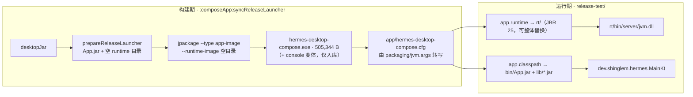

# 05 · 打包与配置

> 本文回答两件事：**成品目录长什么样**、**程序从哪里读配置**。
> 打包方式的取舍见 [`../../草案/07-decisions.md`](../../草案/07-decisions.md) ADR-026 / ADR-027。
>
> 状态：**已实现**（分批交付记录见 §11；启动器与 jpackage 结论更新于 2026-10-28）。
>
> **2026-11-01 改名**：产物名从 `Hermes` 改为 **`hermes-desktop-compose`**（`composeApp/build.gradle.kts`
> 的 `appName`）。因此本文所有 `Hermes.exe` / `app/Hermes.cfg` / `Hermes-console.exe` 在 v0.3.0 起
> 分别是 `hermes-desktop-compose.exe` / `app/hermes-desktop-compose.cfg` /
> `hermes-desktop-compose-console.exe`；标注日期的历史实测记录保留原名不改。
> **没改**：单实例互斥量与计划任务前缀 `HermesCompose-<hash>`（内部标识）、
> 用户数据目录 `%LOCALAPPDATA%\hermes-compose`。
> **2026-11-02 显示名**：界面上的产品名（窗口标题 / 托盘提示 / 系统通知 / 关于页）改为
> **`Hermes Desktop Compose`**（`core/app/ProductInfo.kt` 的 `DISPLAY_NAME`）——
> 裸的 `Hermes` 留给后端 agent 与 payload 进程。
> **发版流程**：patch 发布（只发差异文件、手工上传、覆盖式更新、不走 CI）见技能
> [`global-release-patch`](../../../.ai/skill/global-release-patch/SKILL.md)。

---

## 1. 成品形态

目标是**绿色安装**：整个目录拷走就能在另一台机器跑，不写注册表、不留系统残留、不依赖机器已装的 JDK。

```
App/                         ← 安装根（下文记作 <home>）
├── rt/                      JBR 25 的 jlink 裁剪运行时（60 MB），内含 bin/java.exe
├── hermes/                  内嵌 Hermes sealed payload（Local 模式的后端，约 6.0 GB）
├── data/                    程序数据（首次运行创建）
│   ├── logs/                客户端日志 + 后端控制台日志 backend-*.log
│   └── agent/               后端的 HERMES_HOME（sessions / skills / config.yaml / installs）
├── config/
│   ├── config.json          启动必要配置（唯一的结构化定义处），改了要重启
│   ├── config_custom.json   可选：用户覆盖层，深合并到 config.json（§3.3）
│   ├── options.json         即时生效的可调选项（默认值模板）
│   ├── options_custom.json  可选：用户覆盖层，深合并到 options.json（§3.3）
│   └── state.json           运行态（上次模式 / profile / 草稿 / 窗口位置）
├── lib/                     全部依赖 jar
├── bin/
│   └── App.jar              只含我们自己的类 + Compose 资源
├── hermes-desktop-compose.exe   原生启动器 · 日常（jpackage 生成，约 490 KB，无控制台）
├── app/                     ← jpackage launcher 的固定目录名，非「应用代码」目录
│   └── hermes-desktop-compose.cfg   启动器配置：classpath / mainclass / java-options（§7.6）
└── logs/                    hs_err_pid*.log（首次启动创建）
```

**成品里只有 `hermes-desktop-compose.exe` 一个启动器。** `App.bat` / `App-console.bat` 与
`hermes-desktop-compose-console.exe` 是**开发排障用**的，留在仓库 `packaging/`，不随成品下发
（要临时用就手动拷到成品根目录；console 变体需要同目录的 `app/hermes-desktop-compose-console.cfg`，
成品也没有这份 cfg）。

| 目录 | 职责 | 谁写 |
|---|---|---|
| `rt/` | jlink 裁剪后的 JBR 运行时（`hermes.jmods.dir` 可用时）；用户可整体替换成别的 JBR 变体 | 构建时生成 |
| `hermes/` | 内嵌 Hermes sealed payload | 由发布流程放入；不在运行时下载（见 [`06-本地后端与双模式.md`](06-本地后端与双模式.md)） |
| `config/config.json` | 进程级配置（定义处） | **只有构建下发**（模板；用户改动进 `_custom`） |
| `config/config_custom.json` | 用户覆盖层（可不存） | 设置页 / 用户；升级 `config.json` 时保留 |
| `config/options.json` | 即时生效选项（定义处） | **只有构建下发**（模板） |
| `config/options_custom.json` | 用户覆盖层（可不存） | 设置页 / 用户；升级 `options.json` 时保留 |
| `app/hermes-desktop-compose.cfg` 的 `[JavaOptions]` | JVM 参数默认值（**全项目唯一一处**） | **构建下发**（生成源 `packaging/jvm.args`），随版本刷新 |
| `config/state.json` | 运行态 | **只有程序** |
| `lib/` | 第三方依赖 | 构建时同步 |
| `bin/App.jar` | 主 jar | 构建时同步 |
| `hermes-desktop-compose.exe` | 原生启动器（jpackage 生成；约 494 KB，实测 505,344 B） | 构建生成（§7.6） |
| `app/hermes-desktop-compose.cfg` | 启动器配置；`java-options` 由 `packaging/jvm.args` 转写 | 构建生成（§7.6） |
| `data/` | 程序数据根 | 程序 |
| `data/logs/` | 客户端日志（含后端控制台日志 `backend-*.log`） | 程序 |
| `data/agent/` | 后端的 `HERMES_HOME`（`backend.local.home_dir` 默认值）：sessions / skills / config.yaml / installs | 后端子进程 |

### 1.1 开发目录与成品目录的关系

仓库里新增 `release-test/`（＝上面这个 `<home>` 的实体），**加入 `.gitignore`**。
模板文件放仓库 `packaging/`（可 review），构建任务拷进 `release-test/`。已存在的 `config/*.json` **不覆盖**。

---

## 2. 为什么不用 jpackage 的目录模板，只取它的启动器

`./gradlew :composeApp:createDistributable` 实测产出（2026-10-27，CMP 1.12.2）：

```
Hermes/
├── app/
│   ├── hermes-desktop-compose.cfg                    ← [Application] classpath / mainclass / java-options
│   ├── .jpackage.xml
│   ├── composeApp-desktop-abedd11c…jar
│   ├── animation-core-desktop-1.12.2-e9420621…jar    ← jar 名被追加 hash 后缀
│   ├── icudtl.dat / resources/
│   └── …40+ 个 jar
├── runtime/                          ← jlink 裁剪后的 JRE
└── hermes-desktop-compose.exe
```

**结论：不照搬这个模板，但保留它里面的启动器。**

| 想做的事 | CMP 模板为什么不行 | 直调 jpackage 的做法 |
|---|---|---|
| 把 `app/` 拆成 `lib/` + `bin/` | CMP 把全部 jar 塞进 `app/` 并追加 hash 后缀，主 jar 不再是 `App.jar` | 不用它的输入集合：`--input` 里只放 `App.jar`，产物只取 `exe + cfg`；classpath 手写指向 `bin\App.jar`、`lib\*` |
| 把 `runtime/` 换成 `rt/` | 模板的 `runtime/` 是 jlink 裁剪产物，名字写在生成流程里 | `--runtime-image` 给一个**空目录**，jpackage 便不产 runtime；JVM 由 cfg 的 `app.runtime` 外挂到 `rt\` |
| 启动器位置 | `hermes-desktop-compose.exe` 找 `<exe 同级>\app\<exe 文件名>.cfg`，`app` 目录名**写死**（实测改目录名即报 `Error opening …`） | 接受它：exe 放成品根、cfg 放 `app\`，只有这两个文件，其它目录随便排 |
| 改 cfg 文件名 | — | 实测 cfg 名跟随 exe 名（`Hermes.exe` → `app\Hermes.cfg`；现在 `hermes-desktop-compose.exe` → `app\hermes-desktop-compose.cfg`），exe + cfg 一起改名仍能启动 |

> **2026-10-28 修正**：本文旧版写「`Hermes.exe` 把 `app\Hermes.cfg` 路径编译进镜像」。实测不成立 ——
> 该路径是**运行时**由 exe 文件名推导的（exe 与 cfg 一起改名后照常启动）。真正写死的只有
> `app` 这个目录名和「cfg 必须在 exe 同级目录下」这一条。

`nativeDistributions` 配置保留（将来做 MSI 安装版用），与本文的绿色版**并行不冲突**。

### 2.1 构建期与运行期的分工



链路上两端各自「一次成型」、互不绑定：启动器模板随 JDK 出，JBR 随 `rt/` 出。
实测 **JDK 27 生成的启动器驱动 JBR 25** 正常出窗口（`jvm.dll` 来自 `release-test\rt\bin\server`）。

---

## 3. 配置模型

四个文件，两处定位，一层覆盖。划分依据只有一条：**「改完要不要重启」**——这条线恰好与「谁能改」完全重合，所以不需要第二套规则。

| 文件 | 内容性质 | 谁改 | 生效 | 缺失 | 解析失败 |
|---|---|---|---|---|---|
| `config.json` | 进程级、启动必要 | **只有构建下发**（默认值模板） | 重启 | 生成模板 + 用默认值继续 | **拒绝启动**，指出文件与字段 |
| `config_custom.json` | 覆盖 `config.json` 的用户改动 | 设置页 / 用户 | 重启 | 全部用 `config.json` 的值 | 忽略该文件 + 提示 |
| `options.json` | 用户可感选项（默认值模板） | **只有构建下发** | **立即**（WatchService） | 生成模板 + 用默认值 | 保留旧值 + 提示，**不阻断** |
| `options_custom.json` | 覆盖 `options.json` 的用户改动 | 设置页 / 用户 | **立即** | 全部用 `options.json` 的值 | 忽略该文件 + 保留旧值 |
| `app/hermes-desktop-compose.cfg` 的 `[JavaOptions]` | JVM 参数（唯一源） | 构建（源 `packaging/jvm.args`） | 重启 | 启动器直接报错 | 启动器报错退出 |
| `state.json` | 运行态 | **只有程序** | 下次启动 | 用默认值 | 备份为 `.corrupt` + 用默认值 |

**默认文件只读、用户改动只进 `_custom`**：`config.json` / `options.json` 视为构建产物，
升级时整体替换；用户改过的键写进对应的 `_custom`。这样「哪些值是我改的」一目了然，
升级也不会冲掉设置（§3.3）。

### 3.1 定位：安装目录与 config 目录

**安装目录（下文记作 `<home>`）是所有相对路径的唯一基准。** 不设「相对 config 目录」「相对数据目录」这类第二基准——多重基准是路径类 bug 的头号来源。

`<home>` 解析顺序：

| # | 来源 | 说明 |
|---|---|---|
| 1 | `-Dhdc.home=<path>` | `App.bat` 传的，最高优先 |
| 2 | 环境变量 `HDC_HOME` | 部署面覆盖 |
| 3 | 从 `App.jar` 位置推导 | `<home>/bin/App.jar` → 上两级；若同级无 `bin/`，取 jar 所在目录 |
| 4 | 开发态 fallback：`user.dir` | `./gradlew :composeApp:run` 时没有以上任何一项 |

第 3 条不能省。用户完全可能不用 `App.bat`——做快捷方式、自己拼 `java -cp`、被别的启动器拉起。只靠 bat 传参等于把「不经过 bat 就用不了」写死进设计。

**`config` 目录**解析顺序：

| # | 来源 |
|---|---|
| 1 | `-Dhdc.config_dir=<path>` |
| 2 | 环境变量 `HDC_CONFIG_DIR` |
| 3 | 默认 `config` |

相对路径一律相对 `<home>`。绝对路径原样使用。

**config 目录的位置不能写在 `config.json` 里**——那要先读 `config.json` 才知道它在哪，是循环依赖。

### 3.2 `config.json` 字段

**字段名一律 `snake_case`**——这样 JSON 路径、环境变量名、`-D` 键三者完全同构
（§3.3.3）。Kotlin 侧用 `@SerialName` 对齐，不影响语言习惯。

只放**进程级、改了要重启**的东西。用户可感的选项在 `options.json`，运行态在 `state.json`。

```jsonc
{
  "version": 1,

  "backend": {
    "mode": "local",                         // local | remote（成品默认 local，见 06 篇）

    "local": {
      "hermes_dir": "hermes",                // 内嵌 payload 位置，相对 <home>
      "ready_timeout_ms": 90000,             // 下限 45000
      "extra_args": [],                      // 追加给 hermes dashboard 的参数
      "run_cron": true,                      // = 是否给子进程设 HERMES_DESKTOP=1
      "home_dir": "hermes-home"              // 子进程的 HERMES_HOME，必须是本程序独占目录
    },

    "remote": {
      "base_url": "http://127.0.0.1:9119",
      "token": { "source": "env_file", "value": "C:/ai/hermes/home/.env" },
      "connect_timeout_ms": 10000
    }
  },

  "app": {
    "profile": null,                         // null = 跟随 state.json 里上次选中
    "data_dir": null,                        // null = %LOCALAPPDATA%\hermes-compose；便携填 "data"
    "log_level": "INFO",
    "log": { "dir": "logs", "keep_days": 14, "max_files": 20, "also_stderr": true },
    "window": { "width": 1440, "height": 900, "min_width": 900, "min_height": 600 }
  }
}
```

| 字段 | 默认 | 为什么在 `config.json` 而不是 `options.json` |
|---|---|---|
| `backend.mode` | `remote`（模板）/ `local`（成品 `packaging/config`） | 决定进程启动时加载哪条链路，界面改不了 |
| `backend.local.hermes_dir` | `hermes` | 相对 `<home>`；成品放哪由打包决定，不是用户偏好 |
| `backend.local.ready_timeout_ms` | `90000` | 冷启动容忍；调它的是"我机器慢"这类部署问题 |
| `backend.local.extra_args` | `[]` | 排查手段，不该出现在正常界面里 |
| `backend.local.launch_dashboard` | ~~`true`~~ | **已移除**：后端固定是 `dashboard`（同时提供 RPC/REST 与 Web UI），不再有单独开关 |
| `backend.local.home_dir` | `hermes-home` | 子进程 `HERMES_HOME`；必须独占，指向 `~/.hermes` 会被启动校验拒绝 |
| `backend.remote.base_url` / `token` | 见上 | 启动必要。虽然传输层是每次现取、热改技术上可行，但**不给同一件事留两个家** |
| `app.data_dir` | `null` | 便携模式要跟着安装目录走，属部署选择 |
| `app.log_level` / `log.*` | 见上 | 进程级装配；排查时改文件重启比开界面点更直接 |
| `app.window.*` | 见上 | 首次启动尺寸；之后由 `state.json` 的窗口位置覆盖 |

**单实例不在这里**：桌面端**强制**单实例（[`08`](08-单实例与启动时序.md) §13），没有开关。
原本的 `app.single_instance` 已从 schema 移除，老配置里残留该键只出一条「已废弃」提示。

**不放**的东西：主题/字号/密度/高亮（`options.json`，要热生效）、上次模式与草稿（`state.json`，程序写）、
窗口位置（`state.json`，每次拖动都变）。

`app.profile` 给 `null` 表示「跟随上次选中」，非 null 表示「锁死」——锁死用于一份安装固定跑某个 profile
（想同时开两份不同 profile，得用两个 `<home>`，单实例是按 `<home>` 隔离的，见 `08` §4）。

### 3.3 覆盖层：`_custom` 文件深合并 + 环境变量

#### 3.3.1 覆盖用「同类型文件深合并」，不做第二种格式

覆盖机制只有一条：**在基础文件旁边放一个 `_custom` 后缀的同类型文件，加载时深合并。**

```
config/config.json            基础值（唯一的结构化定义处，构建下发）
config/config_custom.json     可选，覆盖值（同名键盖掉基础值）
config/options.json           基础值（同上）
config/options_custom.json    可选，覆盖值
```

| 方案 | 判断 |
|---|---|
| `override.properties`（扁平键值） | ❌ 引入第二种格式：多一套解析、多一套类型约定、多一套错误信息；且改一个嵌套值要凭空知道键名怎么拼 |
| 两份完整 JSON（`config.json` / `config.properties` 都定义全部项） | ❌ 两个定义源必然漂移 |
| **`*_custom.json` 深合并** | ✅ 只有一种格式一套解析；覆盖文件天然可以只写要改的部分；未知键直接被忽略，不破坏加载 |

`*_custom.json` 的定位：**用户自己的覆盖层**。升级时替换基础文件（新版默认值），
`_custom` 原样保留——这是"升级不丢用户设置"的标准做法（与
`appsettings.Development.json`、`docker-compose.override.yml` 同一思路）。

**设置页只写 `_custom`**（`FileSettingsStore`），并且**只写用户动过的键**：

| 行为 | 结果 |
|---|---|
| 打开设置页、不改任何项、点保存 | **不落盘**（`dirty` 为空 → 不生成/不改动 `_custom` 文件） |
| 改 `app.close_to_tray` | `config_custom.json` 里只有 `{"app":{"close_to_tray":false}}`，其它键不出现 |
| 把可空项清空（如 `app.profile`） | 写入 `null`（`null` 是有效覆盖，见 §3.3.2） |
| 改 `options.*`（界面/网络） | 写 `options_custom.json`，即时生效 |

「只写改过的键」不是优化而是正确性要求：若把全部字段都抄一遍，`_custom` 会变成一份
完整配置的副本，之后基础文件的默认值升级就再也影响不到用户——覆盖层的意义随之消失。

#### 3.3.2 深合并规则

| 值类型 | 规则 | 例 |
|---|---|---|
| 对象 | **递归合并**，逐键覆盖 | custom 只写 `{"backend":{"remote":{"base_url":"..."}}}` → 其它 `backend.remote.*` 保持基础值 |
| 数组 | **整体替换**（不拼接） | custom 写 `"extra_args": []` → 结果是空数组，不会与基础值合并 |
| 标量 | 覆盖 | `"log_level": "DEBUG"` |
| `null` | **覆盖成 `null`**（不是删除该键） | `"profile": null` 有意义（= 跟随上次选中） |

数组为什么是替换而不是拼接：拼接会产生**删不掉**的元素——用户想把基础值里的
`["--isolated"]` 去掉，拼接语义下无论怎么写都做不到（写空数组会变成"基础值不动"）。

#### 3.3.3 统一 key 空间：`snake_case` 路径

所有载体共用同一个键名，就是 `config.json` 里的路径：

```
backend.remote.base_url
app.log.keep_days
```

因为字段名本身已是 `snake_case`（§3.2），映射规则唯一且**零歧义**：

| 载体 | 写法 | 示例 |
|---|---|---|
| `config.json` / `config_custom.json` | 嵌套对象 | `{"backend": {"remote": {"base_url": "..."}}}` |
| 环境变量 | `HDC_` + 键大写、`.`→`_` | `HDC_BACKEND_REMOTE_BASE_URL=http://...` |
| JVM 参数 | `-Dhdc.` + 键 | `-Dhdc.backend.remote.base_url=http://...` |

> 若字段用 `camelCase`，`baseUrl` 该变成 `BASE_URL` 还是 `BASEURL` 就必然出错，
> 而**拼错的变量名只会静默无效**。所以 §3.2 统一 `snake_case` 不是风格偏好，是这条映射成立的前提。

前缀 **`HDC_`**（Hermes Desktop Client），不用 `APP_`：
- `APP_` 太通用，`APP_HOME` / `APP_DATA` 这类名字很多软件在用，撞了难查
- 也不带 `hermes` 字样：后端自己占用 `HERMES_HOME` / `HERMES_DESKTOP` /
  `HERMES_DASHBOARD_SESSION_TOKEN`，Local 模式下子进程会继承环境，带 `hermes` 就有污染风险

`HDC_` 同样有兜底：Local 模式 spawn 子进程时**白名单传环境变量**（`06-本地后端与双模式.md` §4.2），
我们自己的 `HDC_*` 一个都不传。

#### 3.3.4 四个来源与优先级

```
1. -Dhdc.*               启动参数，最显式
2. HDC_*                 环境变量，部署面
3. config_custom.json    用户覆盖层（深合并到基础值上）
4. config.json           唯一的结构化定义处
5. 内置默认值
```

`-D` 高于环境变量，与 Java 惯例一致。

**不设第三份"整段 JSON 环境变量"**（曾考虑过 `HDC_CONFIG_JSON`，已移除）：
容器/CI 场景直接挂载一个 `config_custom.json` 即可，比把 JSON 塞进环境变量可靠得多
（实测 cmd 里传含 `&` 的 JSON 会被截断，见 §3.3.6）。少一条路径就少一套优先级与失败模式。

#### 3.3.5 引导变量（不在 key 空间内）

这三项在读取 `config.json` **之前**就要用，所以不属于配置内容，单独命名：

| 载体 | 作用 | 优先级 |
|---|---|---|
| `-Dhdc.home` / `HDC_HOME` | 安装目录 `<home>`（§3.1） | `-D` > env > jar 位置推导 > `user.dir` |
| `-Dhdc.config_dir` / `HDC_CONFIG_DIR` | config 目录（§3.1） | `-D` > env > `config` |

`config_custom.json` 文件名固定，不做成可配——它必须与基础文件同目录，改名没意义。

#### 3.3.6 复杂值怎么传（实测边界，别以为能随便传）

**先说结论**：环境变量/`-D` 的定位是**"部署时改一两个标量"**（换地址、改日志级别、改超时）。
复杂结构（`extra_args`、`token` 对象）一律写 `config_custom.json`。

实测（2026-10-27，cmd.exe + PowerShell，JBR 25）：

| 值种类 | `cmd` 里 `set` | PowerShell `$env:X=` | 结论 |
|---|---|---|---|
| `["--isolated","--skip-build"]` | ✅ 原样 | ✅ 原样 | 可用 |
| `{"source":"env_file","value":"C:/x/.env"}` | ✅ 原样 | ✅ 原样 | 可用 |
| `{"x":"1&2"}`（含 `&`） | ❌ **被截断**成 `{"x":` + 报 `'2"}' 不是命令` | ✅ 原样 | cmd 需 `^` 转义 |
| `{"x":"1^&2"}` + `set "VAR=…"` | ✅ 得到 `{"x":"1&2"}` | —— | `^` 转义有效，但必须用**引号包法** |
| `100%done` | ❌ 变成 `100done` | ✅ 原样 | cmd 需写 `%%` |
| `set B={...}`（无外层引号） | ❌ `^` 被当字面量保留 | —— | 必须 `set "VAR=…"` |

根因：`cmd` 在**引号配对之前**就解析 `&`/`|`，而 JSON 里的 `"` 会提前闭合 `set "VAR=…"` 的外层引号。
这是 shell 的固有规则，不是解析器能补救的。

| 场景 | 推荐做法 |
|---|---|
| 换后端地址 / 日志级别 / 超时 | 环境变量、`-D`，或 `config_custom.json` ✅ |
| 改 `extra_args`、`token` 对象 | **`config_custom.json`** |
| 值里确实含 `&` `%` 且必须走 cmd | `set "VAR=…^&…"`，或 `set /p VAR=<file`（实测原样读取） |

```powershell
# PowerShell：复杂值无转义问题
$env:HDC_BACKEND_LOCAL_EXTRA_ARGS = '["--isolated","--skip-build"]'
.\hermes-desktop-compose.exe        # 开发时也可用 .\App.bat（不随成品下发）
```

```bat
rem cmd：标量无所谓；含 & 的值必须 ^ 转义且用引号包法
set "HDC_LOG_DIR=logs\dev"
set "HDC_PROFILE=work"
```

#### 3.3.7 解析与校验策略

| 情形 | 处理 |
|---|---|
| 标量值不是合法 int/bool/enum | **拒绝启动**，错误里给出：键名、原值、期望类型 |
| `backend.mode` 不是 `local`/`remote` | 拒绝启动 |
| `backend.local.ready_timeout_ms < 45000` | 拒绝启动（冷启动必然超时，宁可当场报） |
| `config.json` / `config_custom.json` 不是合法 JSON | **拒绝启动**，指出文件与位置 |
| **任一文件里出现 schema 外的键** | **记 WARN 后继续**（用户明确要"未知值能通过，因为不会被映射和使用"） |
| 未知的 `HDC_*` 环境变量 | 记 WARN，继续（可能是给别的软件的） |

未知键只 WARN 不阻断，代价是**拼错的键会静默无效**。所以 WARN 必须带上"该键未被识别"的原文，
并且已知键集合**不手写维护**：用 `AppConfig.serializer().descriptor` 遍历字段名生成。
排查时一条 grep 就能看到 `WARN 未知配置键: backend.remote.base_urll`。

这条与 `capabilities` 那次「0 个技能」是同一个教训的另一面：**类型错误要大声失败，
但"多了个不认识的名字"不该让程序起不来**——前者是数据坏了，后者可能只是给新版本预留的键。

#### 3.3.8 四个典型用法

```bat
rem 换后端地址，不动文件
set "HDC_BACKEND_REMOTE_BASE_URL=http://192.168.1.10:9119"
hermes-desktop-compose.exe
```

```jsonc
// config\config_custom.json —— 只写要改的键，不用动 config.json
{
  "backend": { "remote": { "base_url": "http://192.168.1.10:9119" } },
  "app": { "log_level": "DEBUG" }
}
```

```bat
rem 换 config 目录（相对安装目录）
set "HDC_CONFIG_DIR=..\shared-config"
hermes-desktop-compose.exe
```

```jsonc
// 想清空基础值里的数组 —— 整体替换，写空数组即可
{ "backend": { "local": { "extra_args": [] } } }
```
### 3.4 `options.json`

字段名同样 `snake_case`（理由见 §3.3.3），将来若要支持覆盖，键空间可与 `config.json` 共用一套规则。

```jsonc
{
  "version": 1,
  "ui": {
    "theme": "system",          // light | dark | system
    "font_scale": 1.0,          // 0.8–1.5
    "density": "comfortable"    // compact | comfortable
  },
  "chat": {
    "render_markdown": true,    // false = 显示源码
    "code_highlight": true,
    "show_tool_call_details": true
  },
  "network": {
    "request_timeout_ms": 30000,
    "write_timeout_ms": 45000,
    "prompt_ack_timeout_ms": 1800000   // AGENTS.md 硬约束 3
  }
}
```

**立即生效的边界**（实现必须守住）：

| 组 | 生效方式 |
|---|---|
| `ui.*` | `StateFlow` → `collectAsState` → 重组，立即 |
| `chat.*` | 同上，已渲染的气泡随之重组 |
| `network.*` | 每次请求现取，下一请求生效 |
| `prompt_ack_timeout_ms` | 已在飞的请求不重算（改的是下次） |

**实现进度**（2026-10-27，S3a）：

| 字段 | 状态 | 说明 |
|---|---|---|
| `ui.theme` | ✅ 已生效 | `App.kt` 读 `AppOptionsHolder.state` 决定 `darkTheme` |
| `network.*` | ✅ 已生效 | `Timeouts` 三个值改 getter，从 `AppOptionsHolder.current` 现取 |
| `ui.font_scale` / `ui.density` | ⬜ 待做 | 需要先改 `Theme` 的排版与密度，属 P6 设置页 |
| `chat.*` | ⬜ 待做 | 需要 `MessageItem` / `MarkdownText` / `ToolCallCard` 消费 |

> **解析了但没消费的字段一律不进模板**——否则是假开关，用户改了没反应比没有更糟。
> `packaging/config/options.json` 只列已实现的 `ui.theme` 与 `network.*`；
> `AppOptions` 里的 `font_scale` / `chat.*` 已定义（解析可用），只是暂未接线。

**本期 `options.json` 不做环境变量覆盖**——它本来就是"用户可改、要热生效"的东西，
覆盖层的价值在部署面（`config.json`）。真需要时按同一套 key 空间加，不需要新规则。
用户侧的覆盖走 `options_custom.json`（§3.3），语义与 `config_custom.json` 完全一致。

不进 `options.json` 的东西及理由：

| 项 | 归属 | 理由 |
|---|---|---|
| `baseUrl` / token | `config.json` | 启动必要，避免两个家 |
| JVM 参数 | `app/hermes-desktop-compose.cfg` 的 `[JavaOptions]` | launcher 只认 cfg；bat 也解析它，单一来源 |
| 上次模式 / profile / 草稿 | `state.json` | 程序写，用户不该手改 |
| 窗口大小位置 | `state.json` | 同上，且每次拖动都在变 |

### 3.4.1 设置页：字段目录 + 只写 `_custom`

设置页入口在左侧 rail 的「能力」之后，布局与「能力」页一致：**左栏是分组列表、右栏是表单**
（`feature/settings/`）。

字段目录是**唯一事实源**（`SettingsCatalog`）：

| 概念 | 规则 |
|---|---|
| `key` | JSON 路径（`app.close_to_tray`）；`options.` 前缀表示它属于 `options.json` |
| `scope` | 有 `options.` 前缀 → `LIVE`（写 `options_custom.json`，立即生效）；否则 `RESTART`（写 `config_custom.json`） |
| `kind` | `TEXT` / `NUMBER` / `BOOLEAN` / `ENUM`，页面按它自动挑控件（开关 / 过滤芯片 / 输入框），**不写死表单** |
| `nullable` | 可空项允许清空 → 写入 `null`（不是删键） |

新增一个可配置项 = 在 `SettingsCatalog` 加一行 + 在对应 data class 加字段，**页面不用改**。

保存语义（`SettingsViewModel`，每条都有单测）：

| 场景 | 行为 |
|---|---|
| 只改 `options.*` | 只写 `options_custom.json`，提示「已保存，立即生效」 |
| 改了 `app.*` / `backend.*` | 写 `config_custom.json`，提示「重启客户端后生效」，并出现「重启客户端」按钮 |
| 未改任何项就点保存 | 不落盘（`dirty` 为空） |
| 数字项填了非数字 | 就地报错、**一个键都不写** |
| 保存写盘失败 | 显示原因，不静默吞掉 |

「重启客户端」（`core/app/AppRestarter`）：
- 用**自己的命令行**重启：先 `ProcessHandle`，拿不到时回退 `GetCommandLineW` + `CommandLineToArgvW`
  （`ProcessHandle.Info.arguments()` 在 Windows 上可能为空，实测导致新进程只收到一个 `javaw.exe`
  然后打印 java 用法说明退出 —— 旧窗口关了、新窗口没起来）。
- 顺序：停后端 → 起新进程 → **确认新进程活了（2.5 s）才退出当前进程**；起不来就留住窗口并报原因，
  新进程输出落 `logs/restart.log`。
- 剥掉 `--silent` / `--tray`（用户正对着设置页，重启后必须能看到窗口）。
- 开发态（`gradlew run`，classpath 是 classes 目录）不支持 —— 那里的命令行属于 Gradle。

表单初值来自「当前生效配置 + 默认值全量」（`ConfigJson` 为了"只写改过的键"关了 `encodeDefaults`，
所以快照必须用单独的 `Json { encodeDefaults = true }`，否则表单全空）。

### 3.5 JVM 参数：`app/hermes-desktop-compose.cfg` 的 `[JavaOptions]`

### 3.5 JVM 参数：`app/hermes-desktop-compose.cfg` 的 `[JavaOptions]`

JVM 参数**只有一份**：成品里的 `app/hermes-desktop-compose.cfg`。原生启动器（`hermes-desktop-compose.exe`）只认它，
`App.bat` 也解析同一份（§7.1）—— 所以不存在"改了这个文件、另一个启动方式不生效"的错位。

构建期把 `packaging/jvm.args`（仓库内，构建源，**不下发**）逐行转写成 `java-options=`：

```
# packaging/jvm.args
# 堆上限；Compose/Skiko 渲染大图时 512m 会 OOM
-Xmx1g
# JDK 24+ 必须显式开 native access，否则 Skiko 加载 native 库会被阻止（见 §6.3）
--enable-native-access=ALL-UNNAMED
```

```ini
; release-test/app/hermes-desktop-compose.cfg（构建产物）
[JavaOptions]
java-options=-Djpackage.app-version=1.0.0
java-options=-Dhdc.home=$ROOTDIR
java-options=-XX:ErrorFile=$ROOTDIR\logs\hs_err_pid%p.log
java-options=-Xmx1g
java-options=--enable-native-access=ALL-UNNAMED
java-options=-Dfile.encoding=UTF-8
...
```

| 规则 | 说明 |
|---|---|
| 一行一个参数 | 与 `jvm.args` 同构，转换只是加前缀，不解析、不合并、不改写 |
| `#` 与空行 | 构建时跳过，不进 cfg |
| `$ROOTDIR` / `$APPDIR` | 启动器与 bat 都会展开（`$ROOTDIR` = exe/bat 所在目录） |
| 用户覆盖 | 写 `config/jvm.args.local`（一行一个参数）；**只有 `App.bat` 读它**，`hermes-desktop-compose.exe` 不读 —— 而 `App.bat` **不随成品下发**，所以成品里改参数只能改 `app\hermes-desktop-compose.cfg`（§7.6） |
| 为什么不给 launcher 留外部参数文件 | jpackage launcher 不支持外部 args 文件；`JDK_JAVA_OPTIONS` 实测无效，只有 `JAVA_TOOL_OPTIONS` 生效（全局、会污染子进程） |

> **2026-10-28 变更**：此前是 `config/jvm.args`（bat 读）+ `app/Hermes.cfg`（launcher 读）两份，
> 同一个参数要改两处，且两种启动方式的读法不一致。现在统一成 cfg 一份，bat 用 `for /f` 解析同一份。
> 旧版下发的 `config/jvm.args` 会在 `syncReleaseConfig` 时被清理掉，避免"改了没用"的假象。

### 3.6 `state.json`

`AppPreferences` 现有的全部键，`multiplatform-settings` 的扁平 key-value 语义**不变**，只换落盘后端：

| 键 | 值 |
|---|---|
| `ui.mode` | `sessions` / `capabilities` |
| `ui.activeProfile` | 上次选中的 profile |
| `ui.windowBounds` | `x,y,w,h`（✅ 已实现） |
| `groups.collapsed` | 折叠的分组集合（逗号分隔） |
| `drafts.<sessionId>` | 会话草稿 |
| `conn.baseUrl` | **迁移后移除**（改由 `config.json` 提供） |

**窗口几何存成一个字符串**而不是四个键：`Settings` 没有批量原子写，四个键要落盘四次，
还可能读到"位置更新了尺寸没更新"的中间态。最大化时记的是**还原后**的 bounds
（`WindowPlacement.Floating` 才写），下次启动先按普通窗口恢复。

---

## 4. `Settings` 后端替换（方案 A）

`multiplatform-settings-jvm-1.3.0` 的实测能力：

| 能力 | 结论 |
|---|---|
| `PreferencesSettings` | 当前用的，落 Windows 注册表 `HKCU\Software\JavaSoft\Prefs\dev\shinglem\hermes` |
| `PropertiesSettings` | 存在，但底层 `java.util.Properties`，文件格式是 `key=value`，**不是 JSON** |
| `ObservableSettings` | 只监听经由 API 的写入（内存回调），**监听不到外部改文件** |
| `Settings` 接口 | 扁平 key-value，只支持 6 种标量，**不支持嵌套与数组** |

因此：

1. `options.json` / `config.json` 是**嵌套结构化**配置 → 用 kotlinx-serialization 的 `@Serializable data class`，
   不套 `Settings`。两者都开 `ignoreUnknownKeys` + `coerceInputValues`（与 `RpcJson.json` 一致）。
2. `state.json` 是**扁平 key-value** → 保留 `Settings` 抽象，自写 `JsonFileSettings : Settings`：

```kotlin
class JsonFileSettings(private val file: File) : Settings {
    // get*/put*/remove/clear/keys/hasKey/size 全部转发到内存 JsonObject
    // 写操作后延迟 200ms 落盘（合并高频写，草稿是逐字写的）
}
```

代价约 100 行，**`AppPreferences` 的调用点一行不改**——它依赖的仍是 `Settings` 接口。

> `multiplatform-settings` 库本身保留：`Settings` 接口、`MapSettings`（测试用）、`getStringOrNull` 等扩展仍有价值。

**实现要点**（2026-10-27 落地，见 §11.3）：

| 约束 | 做法 | 为什么 |
|---|---|---|
| UI 线程不被写盘拖住 | 写操作只改内存，落盘推迟 200ms | 会话草稿逐字写，每字一次同步 IO 会卡输入 |
| 进程被杀不留半个文件 | 写 `state.json.tmp` → `Files.move(ATOMIC_MOVE)` | 半个 JSON 会让下次启动直接走损坏分支、丢全部偏好 |
| 文件坏了不阻断启动 | 备份成 `state.json.corrupt` + 用默认值 + WARN | 丢的是"上次选中哪个会话"，不值得拒绝启动 |
| 退出不丢最后 200ms | `AppContainer.close()` 调 `preferences.flush()` | 关窗口前刚改的东西必须落盘 |
| 字符串不被当成数字 | `getIntOrNull` 等只认非字符串标量 | `"42"`（字符串）与 `42` 是不同语义 |

**一次性迁移**：旧版 `PreferencesSettings` 把偏好写在 `HKCU\Software\JavaSoft\Prefs\dev\shinglem\hermes`。
`state.json` 不存在且注册表有键时搬一次（键名两边一致，逐个搬字符串即可，Java Preferences 会自动解码
`/uXXXX` 转义），成功后 `node.removeNode()` 删掉**自己那一层**。

> ⚠️ 不能写成 `Preferences.userRoot().removeNode()` —— 那会清空整个 `HKCU\Software\JavaSoft\Prefs`，
> 连 JetBrains 等其它程序的偏好一起删（实测本机该节点下确实有 `jetbrains\*`）。

---

## 5. 加载与生效链

### 5.1 启动时序

```
hermes-desktop-compose.exe（成品只有它；开发时也可 App.bat，读同一份 cfg）
 ├─ 定 <home> = exe 所在目录          （不依赖 CWD）
 ├─ 读 app\hermes-desktop-compose.cfg：app.runtime / app.classpath / app.mainclass / java-options
 └─ "<home>\rt\bin\java.exe" <opts> -cp "<home>\bin\App.jar;<home>\lib\*" dev.shinglem.hermes.MainKt
   │
   main()
   1. 定 <home>：-Dhdc.home → HDC_HOME → jar 位置推导 → user.dir（§3.1）
   2. 定 configDir：-Dhdc.config_dir → HDC_CONFIG_DIR → "config"（相对 <home>）
   3. 读 config.json（缺失→模板+默认；坏→JOptionPane 报错退出）
   4. 深合并覆盖层：读 config_custom.json（存在则按 §3.3.2 递归合并到上一步结果上）
   5. 叠加单点覆盖：-Dhdc.* / HDC_*（§3.3.4）
      └─ 任一类型/枚举/范围非法 → JOptionPane 报错退出，指明键名与原值
      └─ 任一文件里 schema 外的键 → WARN 后继续，不阻断
   6. 读 options.json（缺失→模板+默认；坏→默认+标记，待 UI 起来提示）
   7. 启动 OptionsWatcher（watch configDir）
   8. 装 AppLogger（路径按 app.data_dir / app.log.* / log_level）
   9. 选 BackendProvider（按 backend.mode），构建 DesktopContainer
      （state.json 由 JsonFileSettings 提供，落在 configDir）
  10. application { … }：先出窗口 → provider.start() → Ready 后 gateway.start()
```

第 3/4 步失败必须**在装 logger 之前**用 `JOptionPane.showMessageDialog` 报错——此时日志还没初始化，写日志等于没写。

覆盖层在**读文件之后、消费方之前**一次性合成一个 `AppConfig` 不可变对象，之后全程只读它。
不做「每次用到时再查一次环境变量」——那会让配置在运行期漂移，也让测试无法固定输入。

### 5.2 热生效机制

```
OptionsWatcher (WatchService on <home>/config, ENTRY_MODIFY|ENTRY_CREATE)
  ├─ 事件到达 → debounce 300ms（编辑器保存常连发多个事件）
  ├─ 读文件 → 解析
  │    ├─ 成功 且 内容 hash ≠ 上次写入 hash → AppOptionsHolder.set(new)
  │    ├─ 成功 且 hash 相同                 → 忽略（这是自己写的回音）
  │    └─ 失败                              → 保留旧值 + 记 WARN + UI 提示
  └─ 单文件连续失败 ≥3 次 → 暂停对该文件的监听 5s（防止半写入文件被反复读）
```

消费端：

| 消费点 | 读法 |
|---|---|
| Compose UI | `options.collectAsState()` |
| `Timeouts` 常量 | 改为 `AppOptionsHolder.current.network` 现取（`StateFlow.value` 无锁） |
| `Log.level` | `Log.level = options.ui…` 由同一个 watcher 推 |

**关键：`Timeouts` 保持 `object`，只把取值来源从字面量换成 `AppOptionsHolder.current`**，这样业务代码的
`Timeouts.DEFAULT_MS` 调用点零改动。

### 5.3 回音消除

程序自己写 `options.json`（界面里调了字号）也会触发 `ENTRY_MODIFY`。处理：

1. 写之前先把新内容序列化，算 SHA-256，存进 `lastWrittenHash`
2. watcher 读到内容后算 hash，与 `lastWrittenHash` 相等则不推送

不用时间窗去猜（时间窗在多进程 / 慢磁盘下不可靠）。

---

## 6. `rt/` 从哪来

**基线已定为 JBR 25**（不是"以后再说"）。**不让构建脚本下载 JDK**（代理与离线环境都不可靠）。解析顺序：

```
-Phermes.rt.dir=<path>              ← 显式指定运行时 JDK（Temurin 27）走这里
  ↓ 未指定
local.properties 里的 hermes.rt.dir ← 本机路径，**不入库**（local.properties 已在 .gitignore）
  ↓ 未指定
Gradle toolchain 的 JDK 25          ← javaToolchains.launcherFor { languageVersion = 25 }
  ↓ 未找到
任务失败，提示安装 JDK 25 或设 hermes.rt.dir
```

本机实测值（2026-10-27）：

| 项 | 值 |
|---|---|
| JBR | `C:\envir\java\version\jbr-25.0.4.1-windows-x64-b635.79` |
| 版本 | `openjdk 25.0.4.1 2026-08-18` / `JBR-25.0.4.1+1-635.79-nomod` |
| 厂商 | `IMPLEMENTOR="JetBrains s.r.o."` |
| 备注 | 该 JBR **未被 Gradle toolchain 自动探测到**（`installations.paths` 里只有 `jdk-25.0.4.1`），所以必须走显式路径，不能指望自动发现 |

**静默降级是禁止的**：找不到就是找不到，不能让 `release-test` 出来一个少了 `rt/` 的目录。
且要检查 `rt/bin/java.exe` 存在，而不只是 `rt/` 目录存在。

### 6.1 完整 JDK 还是 jlink 裁剪

**已改为 jlink 裁剪（2026-10-29，§11.7）**。原表留作背景：

| 方案 | 体积 | 风险 |
|---|---|---|
| 完整复制 JDK | 约 170 MB / 470 文件 | 无；但含 javac、`ct.sym`、全部 locale、调试信息 |
| `jlink --strip-debug` 裁剪 | **约 60 MB / 232 文件**（实测） | Compose/Skiko 走 JNI + 反射 + `ServiceLoader`，模块漏一个就是运行时 `NoClassDefFoundError` —— 模块清单见 §11.7，必须配冒烟测试 |

裁剪的前提是**含 `jmods/` 的 JDK**：官方 **Temurin JDK** 自带 `jmods/`（JRE 包没有）。
`hermes.rt.dir` 与 `hermes.jmods.dir` 必须指向同一份 JDK，否则 jlink 出来的是另一份运行时，
"开发态与成品同 JDK"这条保证就断了。

```properties
# .local/local.properties（本机路径，整个 .local/ 不入库）
# 基线：官方 Temurin 27（自带 bin/jpackage.exe 与 jmods/）。
hermes.rt.dir=D:\\jdk\\temurin-27
hermes.jmods.dir=D:\\jdk\\temurin-27
```

> 配置优先级：`-Phermes.rt.dir=…` > `.local/local.properties` > 仓库根的 `local.properties`（老布局兼容）。
> 没配时退到 Gradle 自己的 JDK。

**没配 jmods 也能出成品**：`syncReleaseRt` 退回整目录拷贝（会自动排除 `jmods/`，那是构建输入不是运行时），
流程不失败。这样别人的克隆不需要先配 JDK 路径才能打包。

### 6.2 Temurin 27 已实测（2026-11-04）

| 项 | 结果 |
|---|---|
| 编译 `jvmTarget = JVM_25` | ✅ 通过（Kotlin 2.4 的 `JvmTarget` 最高 25，没有 `JVM_27`） |
| `desktopTest` | ✅ 全绿 |
| 起窗口 + 渲染 + 中文 | ✅ 正常（字体由随包 Inter / JetBrains Mono 补） |
| 触摸输入 | ✅ 真 press/move（JBR 会把触摸合成为滚轮，这正是当初换掉它的原因） |
| 原生库（公式引擎） | ✅ `ratex-native-windows-x86-64` 由普通 Maven 依赖提供，与 `java.home` 无关 |

历史（JBR 25，2026-10-27）的实测记录与"为什么曾经选 JBR"已归档在
[`07-decisions.md`](../../草案/07-decisions.md)；**当前基线是官方 Temurin 27**，
CI 的 `toolchain-windows` 也用它生成启动器与裁剪运行时。

### 6.3 JDK 24+ 的 native access 限制（实测踩到）

JDK 25 下启动会打印：

```
WARNING: A restricted method in java.lang.System has been called
WARNING: java.lang.System::load has been called by org.jetbrains.skiko.LibraryLoader
WARNING: Restricted methods will be blocked in a future release unless native access is enabled
```

| 项 | 内容 |
|---|---|
| 现象 | Skiko 加载 native 库触发 JEP 472（Restricted Methods）警告 |
| 原因 | JDK 24 起 `System.load` 等被标记为受限方法，需显式 `--enable-native-access` |
| 后果 | 现在只是警告；**未来 JDK 会直接阻止**，那时应用起不来 |
| 应对 | `packaging/jvm.args`（→ `app/hermes-desktop-compose.cfg` 的 `java-options`）默认包含 `--enable-native-access=ALL-UNNAMED`；不要等它变成错误 |

**2026-11-01 扩展**（终端改 Compose 原生渲染后）：需要这条 flag 的**不再只有 Skiko**，共三处 ——
① Skiko 的 `System.load`；② **JNA**（pty4j 的 ConPTY 绑定，`jna-5.14.0`）；
③ `java.lang.foreign`（`Elevation` / `SingleInstance` / `WindowsJobObject` 里的
`SymbolLookup.libraryLookup("kernel32")`）。在裁剪运行时上实测：带 flag 完全静默，
去掉则刷 `A restricted method in java.lang.foreign.SymbolLookup has been called` +
`Restricted methods will be blocked in a future release`。**不需要**额外 `--add-opens`，
也**不需要**给 JNA 指 `jna.tmpdir`（pty4j 的 native 解包到 `java.io.tmpdir`，实测正常）。

这条也顺带证明了这个设计的必要性：**参数必须有一个用户可改的落点** ——
没有它，用户遇到这类问题只能等构建脚本改（`app/hermes-desktop-compose.cfg` 就是那个落点；
`config/jvm.args.local` 只在手动放入 `App.bat` 时才算第二落点）。

---

## 7. 启动器（四个：成品一个，开发三个）

| 文件 | 子系统 | 用途 | 有控制台 | 在成品里 |
|---|---|---|---|---|
| `hermes-desktop-compose.exe` | jpackage 原生启动器（GUI） | 日常使用，推荐入口 | ❌ 无黑框 | ✅ 唯一入口 |
| `hermes-desktop-compose-console.exe` | jpackage 原生启动器（CUI） | 排障：看实时输出、未捕获异常堆栈、JVM 告警 | ✅ 有 | ❌ 开发用 |
| `App.bat` | `javaw.exe`（GUI） | 兜底；参数读同一份 cfg；唯一支持 `jvm.args.local` | ❌ 无黑框 | ❌ 开发用 |
| `App-console.bat` | `java.exe`（CUI） | 兜底排障 | ✅ 有 | ❌ 开发用 |

`java.exe` 的 PE Subsystem = 3（CUI，必带控制台窗口），`javaw.exe` = 2（GUI，不带）。实测确认。

后三者留在仓库 `packaging/`（`hermes-desktop-compose-console.exe` 在 `packaging/launcher/`），
**`syncReleaseTest` 不会把它们拷进成品**；要临时排障就手动拷到成品根目录。
`hermes-desktop-compose-console.exe` 还需同目录的 `app/hermes-desktop-compose-console.cfg`（成品也不下发）。

### 7.1 `App.bat`（日常，无控制台；`--console` 切排障）

参数**全部**来自 `app\hermes-desktop-compose.cfg` —— 与 `hermes-desktop-compose.exe` 同一份，不做第二套配置。
完整文件见 `packaging/App.bat`；下面为省篇幅把嵌套 `if/else if` 压成了单行 `&` 串联，实际是多行块。

```bat
@echo off
chcp 65001 >nul
setlocal enabledelayedexpansion
set "ROOT=%~dp0"
if "!ROOT:~-1!"=="\" set "ROOT=!ROOT:~0,-1!"
set "CFG=%ROOT%\app\hermes-desktop-compose.cfg"

set "SECTION="
for /f "usebackq eol=# delims=" %%a in ("%CFG%") do (
    set "line=%%a"
    if "!line!"=="[JavaOptions]" (
        set "SECTION=java"
    ) else if "!line!"=="[Application]" (
        set "SECTION=app"
    ) else if "!SECTION!"=="app" (
        if "!line:~0,12!"=="app.runtime="   set "RUNTIME=!line:~12!"&set "RUNTIME=!RUNTIME:$ROOTDIR=%ROOT%!"
        if "!line:~0,14!"=="app.mainclass=" set "MAIN=!line:~14!"
        if "!line:~0,14!"=="app.classpath=" set "v=!line:~14!"&set "v=!v:$ROOTDIR=%ROOT%!"&set "v=!v:$APPDIR=%ROOT%\app!"&(if defined CP (set "CP=!CP!;!v!") else (set "CP=!v!"))
    ) else if "!SECTION!"=="java" (
        if "!line:~0,13!"=="java-options=" set "v=!line:~13!"&set "v=!v:$ROOTDIR=%ROOT%!"&set "OPTS=!OPTS! "!v!""
    )
)

set "LOCAL="
if exist "%ROOT%\config\jvm.args.local" (
    for /f "usebackq eol=# delims=" %%a in ("%ROOT%\config\jvm.args.local") do set "LOCAL=!LOCAL! "%%a""
)

start "" "!RUNTIME!\bin\javaw.exe" !OPTS! !LOCAL! -cp "!CP!" !MAIN!
```

解析要点（每条都有实测依据）：

| 目标 | 写法 / 说明 |
|---|---|
| 段切换 | 只比较 `[Application]` 与 `[JavaOptions]` 两行，其余行按当前 `SECTION` 分流 |
| 取键值 | `if "!line:~0,14!"=="app.classpath="` + `set "v=!line:~14!"` —— **偏移必须等于键名长度**，少 1 会多出 `=` |
| 变量展开 | `set "v=!v:$ROOTDIR=%ROOT%!"`：替换串用 `%ROOT%`，**不能**写 `!ROOT!`（见 §9） |
| 多行 classpath | `if defined CP (set "CP=!CP!;!v!") else (set "CP=!v!")` |
| 参数加引号 | `set "OPTS=!OPTS! "!v!""` —— 值里可能有空格（如 `-Dfoo=a b`） |
| 用户覆盖 | `config\jvm.args.local` 在 cfg 之后追加，重复 `-D` 时后出现的生效 |

### 7.2 `App-console.bat`（排障转发）

整个文件只有一行：

```bat
@echo off
call "%~dp0App.bat" --console %*
```

参数解析逻辑只有一份（在 `App.bat` 里），两个入口不会各自漂移。
`--console` 分支用 `java.exe`、同步运行、失败时 `pause`。

### 7.3 设计要点（每条都对应一次实测）

| 做法 | 原因 |
|---|---|
| `chcp 65001` 放在 `@echo off` 之后**第一行** | cmd 逐行读批处理，`chcp` 之前的行按系统 ANSI（GBK）解码 → 中文注释被拆成乱码并当成命令执行（实测报 `'��则' is not recognized`） |
| **注释只用 ASCII**，中文只出现在 `echo` 行 | 即使 `chcp 65001` 在前面，cmd 仍按**字节偏移**定位批处理行，含多字节字符的长文件会错位（实测：注释里的"否则"被当成命令）。短 `echo` 行实测正常 |
| `%~dp0` 定位，不用 CWD | 从快捷方式 / 其它目录启动时 CWD 不是安装根 |
| **不用 `-jar`**，用 `-cp "bin\App.jar;lib\*"` + 主类名 | `-jar` 需要 `MANIFEST` 写 `Class-Path`，93 个依赖手工列出且受 72 字节行宽限制；`-cp` 通配符由 JVM 展开 |
| `App.bat` 在安装根，jar 在 `bin\`，依赖在 `lib\` | 三处都相对 `%~dp0`，**不出现任何 `..\`**（从别的 CWD 启动时 `..` 语义完全不同） |
| `start "" 程序 参数` | 不加 `start` 时 bat 会同步等待 javaw 退出 → 双击后黑框一直存在，等于白用 javaw。实测：加上后 bat 197–210ms 返回 |
| `start ""` 的第一个空参数必须给 | 否则含空格的程序路径会被当成窗口标题 |
| **不用 `>>` 重定向** | `start` 启动的 GUI 子进程会**独占**目标文件句柄，日志连记事本都打不开（实测 `The process cannot access the file`）。改由应用自己写日志 + `-XX:ErrorFile` |
| `-XX:ErrorFile=$ROOTDIR\logs\hs_err_pid%p.log` 写在 cfg 里 | JVM 级崩溃（native crash、OOM killer）不走应用日志；默认写到 CWD，不可控。放 cfg 后 exe 与 bat 共用同一份，不用各写一遍（`%p` 由 JVM 展开，bat 读取时保持字面） |
| `for /f "usebackq eol=# delims=" %%a in ("%CFG%")` | `eol=#` 直接跳过注释行，不必在循环里判断首字符（对空行会崩）；`delims=` 保证整行不被空格切开 |
| 变量替换串用 `%ROOT%`，**不能**用 `!ROOT!` | `set "v=!v:$APPDIR=!ROOT!\app!"` 里第一个 `!` 会在 `!ROOT!` 处提前闭合，实测结果被塞成 `…release-testROOT` |
| `echo. \| pause` 可被脚本管道 | 前置校验失败时 `pause` 需要一次输入；自动化测试用管道喂 |
| 不 `pause` 于 javaw 路径 | javaw 异步，bat 拿不到退出码；崩溃信息在 `logs\` |
| 全路径加引号 | 用户可能装在 `D:\Program Files\` |

### 7.4 编码统一（三层都要管）

| 层 | 手段 | 实测结论 |
|---|---|---|
| **控制台代码页** | bat 里 `chcp 65001 >nul` | 让 bat 的 `echo` 中文正常显示 |
| **bat 文件本身** | UTF-8 **无 BOM** + CRLF | BOM 会让 cmd 把首行读成乱码 |
| **JVM 输出编码** | `-Dstdout.encoding=UTF-8` / `-Dstderr.encoding=UTF-8` | ⚠️ **必须**：JVM 默认取系统 ANSI（实测 `stdout.encoding = GBK`），重定向到文件后按 UTF-8 读就是乱码 |
| **JVM 默认字符集** | `-Dfile.encoding=UTF-8` | JDK 18+（JEP 400）已默认 UTF-8，显式写只为跨版本一致 |
| **应用日志文件** | `File.appendText(..., Charsets.UTF_8)` | Kotlin 的 `appendText` 默认就是 UTF-8，但**要显式写出**，不依赖默认 |
| **配置 / 状态 JSON** | 读写都显式 `Charsets.UTF_8` | 同上，别赖默认 |
| **Local 后端子进程** | `PYTHONUTF8=1` | Windows GBK locale 下 Python stdio 会乱码 |

**不要**设 `sun.jnu.encoding=UTF-8`。它在 Windows 上决定文件名在 Java 与 Win32 API 之间的编码桥接，改了会让中文路径打不开。保持系统默认（实测 `GBK`）。

### 7.5 为什么不用 `>>` 把输出写日志

实测过程：`start "" javaw ... >> log 2>&1` 能拿到日志内容（3467 字节），但**文件被 GUI 子进程独占**，运行期间任何程序（含 `Get-Content`、记事本）都打不开：

```
The process cannot access the file 'start.out' because it is being used by another process.
```

所以方案是：**stdout/stderr 不重定向，让应用自己接管**。`AppLogger` 已落盘到 `<dataDir>\logs\hermes.log`（UTF-8）；JVM 崩溃用 `-XX:ErrorFile`。

> 待补（S2 小项）：`main()` 早期用 `System.setErr` 接管 stderr 到日志文件。现在未捕获异常的堆栈在 javaw 下会丢（`AppLogger` 只记它自己产生的行）。
### 7.6 原生启动器 `hermes-desktop-compose.exe` / `hermes-desktop-compose-console.exe`（jpackage）

由 `:composeApp:syncReleaseLauncher` 用 **JDK 自带的 jpackage** 生成，实测 2.84 s，不 jlink、不拷 runtime。
产物是 `hermes-desktop-compose.exe` + `app\hermes-desktop-compose.cfg`（console 变体只在开发时入库，见下）。生成原理与取舍见 §2.1；
生成的 exe **已入库到 `packaging/launcher/`**，日常出成品直接复用、不再调 jpackage（§8.1）。

```ini
; release-test/app/hermes-desktop-compose.cfg —— 构建生成，别手改（改 packaging/jvm.args 后重新出成品）
[Application]
app.runtime=$ROOTDIR\rt
app.classpath=$ROOTDIR\bin\App.jar
app.classpath=$ROOTDIR\lib\*
app.mainclass=dev.shinglem.hermes.MainKt

[JavaOptions]
java-options=-Djpackage.app-version=1.0.0
java-options=-Dhdc.home=$ROOTDIR
java-options=-XX:ErrorFile=$ROOTDIR\logs\hs_err_pid%p.log
java-options=-Xmx1g
java-options=--enable-native-access=ALL-UNNAMED
java-options=-Dfile.encoding=UTF-8
java-options=-Dstdout.encoding=UTF-8
java-options=-Dstderr.encoding=UTF-8
java-options=-Dstdin.encoding=UTF-8
```

`[JavaOptions]` 以下由 `packaging/jvm.args` **逐行转写**（跳过 `#` 与空行），
所以它依旧是 JVM 参数的唯一事实源，成品里不产生第二份清单。

实测行为（2026-10-28，JDK 27 生成 + JBR 25 运行）：

| 能力 | 结论 |
|---|---|
| `app.runtime` | 绝对路径 / 相对路径（基准 = **exe 所在目录**）/ `$ROOTDIR\rt` 都可；指向**完整 JBR 目录**即可，不需要 jlink 镜像 |
| `app.classpath` | 多行；`$ROOTDIR` / `$APPDIR` 展开；`lib\*` 通配可用（102 个 jar 一次跑通） |
| `java-options` | 可写多行，全部生效；`$ROOTDIR` / `$APPDIR` 在其中也展开 |
| 自动属性 | 启动器注入 `jpackage.app-path`（exe 绝对路径），可替代 `-Dhdc.home` 的推导 |
| 定位规则 | `<exe 同级>\app\<exe 文件名>.cfg`；`app` 目录名写死；exe 可放子目录（子目录下也得有 `app\`） |
| `.jpackage.xml` | 可删，删了照常启动（本项目不留） |
| 进程模型 | launcher 父进程 + JVM 子进程，任务管理器里两条 `hermes-desktop-compose.exe` |
| 失败表现 | **GUI 变体弹模态错误框并卡住进程**（实测缺 runtime 时挂住 >30 s）；排障要把 `Hermes-console.exe` 拷进成品根目录一起用（它不随成品下发） |
| exe 元信息 | VERSIONINFO 来自 `--vendor` / `--app-version` / `--description`；图标来自 `--icon`（见 §7.7） |

**与 bat 的分工**：两者**读同一份 `app\hermes-desktop-compose.cfg`**（§7.1），参数不会漂移。
成品只有 `hermes-desktop-compose.exe`；`App.bat` 与 `hermes-desktop-compose-console.exe` 是开发排障用的，留在 `packaging/`。
`App.bat` 是**唯一支持 `jvm.args.local`** 的路径 ——
原生启动器不读任何外部参数文件（实测 `JDK_JAVA_OPTIONS` 无效，只有 `JAVA_TOOL_OPTIONS` 生效，
但它全局生效还会污染子进程）。所以**成品里改 JVM 参数只能改 `app\hermes-desktop-compose.cfg`**
（注意它随 `packaging/jvm.args` 重新生成，升级会覆盖）。

### 7.7 图标（`packaging/icon.svg` → `.ico` + `.png`）

不传 `--icon` 时 jpackage 会塞 **JDK 自带的咖啡杯** —— 装完在开始菜单、任务栏、文件属性里
看到的都是它。所以图标是构建产物的一部分，不是可选装饰。

| 文件 | 作用 | 谁生成 |
|---|---|---|
| `packaging/icon.svg` | **唯一设计源** | 手写（改图标只改这里） |
| `packaging/icon.ico` | 启动器图标（16/24/32/48/64/128/256 七档） | `pwsh packaging/make-icon.ps1` |
| `composeApp/src/commonMain/composeResources/drawable/icon.png` | 窗口标题栏 / 任务栏 / 托盘（256×256） | 同上（同一份渲染结果） |

**转换怎么做的**：本机没有 ImageMagick / Inkscape / rsvg-convert，所以用系统自带的两样东西 ——
Edge headless（`--headless=new --screenshot --default-background-color=00000000`）把 SVG 渲染成
256×256 透明 PNG，再用 .NET `System.Drawing` 降采样、按 ICO 容器格式打包（Vista+ 支持 PNG 条目）。
脚本没有第三方依赖，也不需要 Python。

**尺寸取舍**：图形只有「圆角方底 + 三个矩形拼的 H」，没有任何细线或文字字形 ——
16 px 时曲线细节会糊成灰点，所以刻意画得粗。

**换图标路径**：

```bash
# 默认 packaging/icon.ico；要换就用属性覆盖（.ico 或 .png，相对路径按项目根解析）
./gradlew :composeApp:syncReleaseTest "-Phermes.icon=D:\brand\hermes.ico"
```

- 图标进了 `inputs.files(...).optional()`：换图会触发 `jpackageReleaseLauncher` 重跑，
  不会留旧 exe（否则 Gradle 判定 `image/` 最新，exe 里永远是上一版图标）。
- **显式指定的文件不存在 → 直接失败**。静默回落到默认图标是最难发现的错：装完看到咖啡杯
  才知道属性没生效。
- MSI / EXE 安装包走 `compose.desktop.nativeDistributions.windows.iconFile`，指向同一个文件。

实测（2026-10-29）：`Hermes.exe` 提取出的 32×32 图标是蓝底白 H；`-Phermes.icon=<橙色变体>`
重建后同一个 exe 变成橙色 —— 覆盖生效；指向不存在的路径时构建报
`hermes.icon 指向的图标不存在：…`；窗口标题栏图标从 Java 默认图标变成同一枚图标。

---

## 8. Gradle 任务（已实现）

八个任务，`syncReleaseTest` 是唯一入口：

| 任务 | 类型 | 作用 |
|---|---|---|
| `syncReleaseTest` | `Sync` | 唯一入口：启动器 + `bin/App.jar` + `lib/*.jar` |
| `syncReleaseRt` | 普通任务 | 准备 `rt/`：有 jmods 时用 jlink 产物**覆盖重写**，否则整目录拷贝（**仅缺失或 `-Phermes.rt.refresh` 时执行**） |
| `jlinkReleaseRuntime` | `Exec` | 用 `hermes.jmods.dir` 的 jmods jlink 出裁剪运行时到 `build/jlink-runtime/`（§11.7） |
| `syncReleaseConfig` | 普通任务 | 写 `config/` 模板（**已存在则不覆盖**），并清理旧版下发的 `config/jvm.args` |
| `syncReleaseLauncher` | 普通任务 | 整理启动器产物：`hermes-desktop-compose.exe` + `app/hermes-desktop-compose.cfg`（cfg 由 `jvm.args` 转写）；exe **默认复用 `packaging/launcher/`**，图标取 `-Phermes.icon`（§7.7） |
| `updateBundledLauncher` | `Copy` | 调 jpackage 重新生成 `hermes-desktop-compose.exe` / `hermes-desktop-compose-console.exe`，写回 `packaging/launcher/`（入库，改完提交） |
| `jpackageReleaseLauncher` | `Exec` | 调 jpackage 生成 app-image（`--runtime-image` 传空目录 → 不产 runtime） |
| `prepareReleaseLauncher` | 普通任务 | 准备输入：`App.jar` + 空 runtime 目录 + console 变体属性文件 |

任务图随配置变化（`--dry-run` 实测）：

```
配了 jmods : jlinkReleaseRuntime → syncReleaseRt → syncReleaseTest
没配 jmods :                       syncReleaseRt → syncReleaseTest
```

### 8.1 启动器入库：`packaging/launcher/`

jpackage 只随 JDK 分发（`rt/` 里的 JBR 是精简运行时，没有 `jpackage.exe`）。把生成的
`hermes-desktop-compose.exe` / `hermes-desktop-compose-console.exe`（各约 500 KB）放进仓库，换来两件事：

| 收益 | 说明 |
|---|---|
| 没装 JDK 也能出成品 | `syncReleaseLauncher` 在默认路径下**不依赖** `jpackageReleaseLauncher`（`--dry-run` 只列自己一个任务） |
| 全项目同一份启动器 | 不会出现「谁的 JDK 生成的就是谁的 exe」，版本差异被收敛 |

```bash
./gradlew :composeApp:syncReleaseTest                      # 默认：复用 packaging/launcher
./gradlew :composeApp:updateBundledLauncher                # 换 JDK / 换图标后刷新入库的那份
./gradlew :composeApp:syncReleaseLauncher "-Phermes.launcher.refresh=true"   # 临时绕过入库副本
```

- **只入库 exe，不入库 cfg**：`app\*.cfg` 随 `appVersion` 与 `packaging/jvm.args` 变，
  每次构建重新写；入库一份旧 cfg 只会造成两套参数（§7.6）。
- **入库两份 exe，成品只带一份**：`syncReleaseLauncher` 只拷 `hermes-desktop-compose.exe`；
  `hermes-desktop-compose-console.exe` 留在 `packaging/launcher/` 给开发排障（`useBundledLauncher`
  也只检查主 exe，缺 console 变体不会触发重新生成）。
- `*.exe` 在 `.gitattributes` 里标了 `binary`，否则 `* text=auto eol=lf` 会改写二进制。
- 入库副本缺失时自动回退到 jpackage（有 JDK 就能补上），不会构建失败。
- 实测（2026-10-29）：入库副本与 jpackage 新生成的文件 SHA-256 完全一致；
  `release-test` 用入库那一份启动正常（窗口 + serve + dashboard）。

```kotlin
// composeApp/build.gradle.kts（实际实现要点）
val hermesRtDir: String? =
    providers.gradleProperty("hermes.rt.dir").orNull?.takeIf { it.isNotBlank() }
        ?: rootProject.file("local.properties").takeIf { it.isFile }?.let { file ->
            Properties().apply { file.inputStream().use { load(it) } }.getProperty("hermes.rt.dir")
        }?.takeIf { it.isNotBlank() }

val syncReleaseTest by tasks.registering(Sync::class) {
    dependsOn("desktopJar", syncReleaseRt, syncReleaseConfig, syncReleaseLauncher)
    into(releaseTestDir)
    from(tasks.named("desktopJar")) { into("bin"); rename { "App.jar" } }
    from(configurations.named("desktopRuntimeClasspath").map { c ->
        c.filter { it.extension == "jar" }.distinct()
    }) { into("lib"); duplicatesStrategy = DuplicatesStrategy.EXCLUDE }
    from(releaseLauncherDir)   // hermes-desktop-compose.exe + app/hermes-desktop-compose.cfg；不含 *.bat / console 变体
    preserve { include("rt/**"); include("config/**"); include("hermes/**"); include("data/**") }
}
```

关键约束：

| 约束 | 理由 |
|---|---|
| `desktopRuntimeClasspath` 而不是 `compileClasspath` | 要带运行时传递依赖（Skiko native、Coil、Ktor 引擎）。实测 93 个 jar / 80 MB |
| **`distinct()` + `EXCLUDE`** | 同一 jar 可能经不同坐标/变体解析到同一文件（实测 `lifecycle-runtime-desktop-2.11.0.jar` 出现两次），`Sync` 会报 `duplicate but no duplicate handling strategy` 直接失败 |
| **`preserve { rt/ config/ hermes/ data/ }`** | `Sync` 默认**删除**目标里源集合未覆盖的文件；不加这段，每次出成品都会清掉用户的 JDK 与配置。这是本项目最危险的一个默认行为 |
| `rt/` 独立任务，不进 `Sync` | 实测完整 JBR 有 470 个文件 / 170 MB，逐文件比对太慢；裁剪后 232 个 / 60 MB，仍然独立成任务 |
| `hermes.rt.dir` / `hermes.jmods.dir` 从 `local.properties` 读 | 本机绝对路径不入库；`local.properties` 已在 `.gitignore` |
| 找不到 `rt` 就 `GradleException` | 不许静默产出缺 `rt\` 的目录 |
| 任务不进 `build` / `assemble` 依赖链 | 这是"手动出成品"的动作，不该被每次构建触发 |
| `compose.components.resources` 的产物在 `App.jar` 内 | 不用额外拷 `resources/` |
| 启动器传 `--runtime-image <空目录>` | jpackage 不校验镜像内容（实测 `exit=0`），于是不 jlink、不拷 120 MB runtime；这是对 jpackage 行为的依赖，升 JDK 后要重测 |
| jpackage 取 Gradle 自己的 JDK | `rt/` 是 JBR 运行时，**没有** jpackage / jlink / jmods；启动器与 runtime 版本无关，不冲突 |
| jlink 的 jmods 必须是**同版本 jbrsdk** | `jbr-*` 包不带 jmods；混用别的 build 等于换了一份运行时（§6.1 / §11.7） |
| 整拷回退 `exclude("jmods/**")` | 源可能指到 SDK（`jbrsdk*`），jmods 是 jlink 的输入（268 MB），运行时不用 |
| cfg 由 `packaging/jvm.args` 生成，不手写 | 保持「JVM 参数只有一个事实源」；成品里不再下发 `config/jvm.args`（残留的会被 `syncReleaseConfig` 清掉），`jvm.args.local` 也只在手动放入 `App.bat` 时生效（§7.6） |
| `preserve { logs/ }` | 启动器的 `-XX:ErrorFile` 落在 `logs\`，用户日志也在那儿；`Sync` 会删未覆盖目录 |
| 源集合就是成品全集 | `Sync` 会删掉目标里未被覆盖的文件 —— 去掉 `*.bat` 与 console 变体后，旧的 `App.bat` / `hermes-desktop-compose-console.exe` / `app/hermes-desktop-compose-console.cfg` 会在下一次 `syncReleaseTest` 自动消失，不需要手工清理 |

实测产出（2026-10-27）：`bin/App.jar` 1.2 MB、`lib/` 93 个 jar 80.2 MB、`rt/` 470 文件 169.6 MB。
实测产出（2026-10-28）：`Hermes.exe` 505,344 B、`app\Hermes.cfg` 504 B，`syncReleaseLauncher` 全程 2.84 s。
实测（2026-10-29）：成品根只剩 `Hermes.exe`，`app\` 只剩 `Hermes.cfg`；启动后 serve/dashboard 正常就绪。

---

## 9. 坑

| 现象 | 原因 | 应对 |
|---|---|---|
| `release-test` 里 `config/` 每次构建被重置，用户改的配置没了 | 用 `Sync` 同步 `config/`，它默认删除多余文件 | `config/` 用 `Copy` + `onlyIf`；模板文件带 `.template` 后缀首次改名为正式名 |
| `release-test/` 被提交进仓库 | 忘了 gitignore，且里面有 jar | `.gitignore` 加 `release-test/`（`*.jar` 那条已覆盖 jar，但 `rt/` 的 `.exe` `.dll` 不在范围内） |
| `App.bat` 双击闪退且看不到原因 | 用 `javaw.exe`，或没 `pause` | `java.exe` + `if errorlevel 1 pause` |
| 从别的目录启动报 `ClassNotFoundException` | `-cp` 用了相对 CWD 的路径 | 全部基于 `%~dp0` |
| 改 `options.json` 程序没反应 | 用编辑器保存时先写临时文件再 rename（`ENTRY_DELETE`+`ENTRY_CREATE`），只监听 `ENTRY_MODIFY` 收不全 | 同时监听 `ENTRY_MODIFY` 与 `ENTRY_CREATE`；watch 的是**目录**不是文件 |
| 程序自己写 `options.json` 触发无限循环 | WatchService 无法区分谁写的 | 内容 hash 比对（§5.3） |
| 半写入的 JSON 被读到，界面反复弹"配置错误" | 大文件写入非原子，中间态被事件捕获 | debounce 300ms + 连续失败 3 次退避 5s |
| 参数文件里的注释被当成参数传给 JVM | 注释行没被跳过 | 构建期跳过 `#` 与空行（不进 cfg）；bat 侧 `for /f "eol=#"` 再兜一层 |
| 换了 `rt/` 后程序起不来但没有提示 | 只检查了 `rt/` 目录存在，没检查 `bin/java.exe` | bat 里检查 `%JAVA%` 文件存在，报明确错误 |
| 便携模式拷走目录后日志还在旧机器路径 | `dataDir` 默认走 `%LOCALAPPDATA%` | `config.json` 的 `app.dataDir` 设 `"data"`（相对 `<home>`）；两处都要测 |
| `config.json` 写坏导致程序静默用默认值硬连 | 用 `runCatching{}.getOrDefault()` 吞异常 | **禁止吞**（与能力页那次"0 个技能"同一个坑）；解析失败拒绝启动 |
| JDK 25 启动刷三行 `WARNING: Restricted methods will be blocked…` | JEP 472：`System.load` 需显式授权 | `jvm.args` 默认带 `--enable-native-access=ALL-UNNAMED`（§6.3） |
| `chcp` 之前的中文行被当成命令执行（`'��则' is not recognized`） | cmd 逐行读批处理，`chcp` 之前按系统 ANSI（GBK）解码 UTF-8 字节 | `chcp 65001` 放在 `@echo off` 之后第一行（§7.3） |
| 即使 `chcp` 在前，长注释行里的中文仍被误解析 | cmd 按**字节偏移**定位批处理行，多字节字符会让偏移错位 | **注释一律 ASCII**，中文只留在短 `echo` 行（§7.3） |
| 重定向的日志文件连记事本都打不开 | `start` 启动的 GUI 子进程独占文件句柄 | 不重定向；应用自己写日志 + `-XX:ErrorFile`（§7.5） |
| 双击 `App.bat` 后黑框一直不消失 | 没用 `start`，bat 同步等待 javaw 退出 | `start "" "%JAVAW%" …`，实测 200ms 返回（§7.3） |
| 加了一个新 bat 后构建就把它删了 | `Sync` 会删除目标里源集合未覆盖的文件；`include("*.bat")` 漏配就静默删除 | 源集合用通配（`include("*.bat")`），并 `preserve { rt/ config/ hermes/ data/ }` |
| 两份 JVM 参数（`config/jvm.args` + `app/hermes-desktop-compose.cfg`）漂移 | 两个启动器各读一份，改一处另一处不生效 | 现在只有 cfg 一份：`packaging/jvm.args` 是构建源，`App.bat` 解析 cfg（§7.1） |
| 重定向到文件的中文变乱码 | JVM 的 `stdout.encoding` 默认是系统 ANSI（GBK），不是 UTF-8 | `-Dstdout.encoding=UTF-8 -Dstderr.encoding=UTF-8`（§7.4，已实测） || 换 `rt/` 后程序起不来但没有任何提示 | 只判断 `rt/` 目录存在 | 判断 `rt/bin/java.exe` 是文件；报明确错误并 `pause` |
| 本地开发跑得好、成品换个 JDK 就行为不同 | 开发态用 27、成品用 25，两套运行时 | S5 把 `:composeApp:run` 也指向 `rt/` 同一份 JDK |
| 设了环境变量但双击启动读不到 | `set X=1` 只影响**当前控制台**；从资源管理器/快捷方式启动继承的是 login 环境 | 用 `setx` 写用户级变量，或在 `App.bat` 里前置 `set`，或用 `-D` |
| `set "VAR={"x":"1&2"}"` 报 `'2"}' 不是命令`，值被截断成 `{"x":` | cmd 在引号配对前就解析 `&`，JSON 里的 `"` 提前闭合了外层引号 | 含 `&` 的值必须 `^` 转义（`^&`）**且**用引号包法；复杂值直接改 `config.json`（§3.3.4 有完整实测表） |
| `set B={...}`（不加外层引号）里 `^&` 变成字面量 `^&` | 只有 `set "VAR=…"` 的引号形式才认 `^` 转义 | 统一写 `set "VAR=…"` |
| 值里的 `%` 消失 | cmd 把 `%x%` 当变量展开 | 写 `%%`；或改用 PowerShell / 配置文件 |
| bat 里中文乱码、或前几行被当成命令执行 | 文件被存成 UTF-8/LF，而 cmd 按本地 ANSI + CRLF 读 | `.gitattributes` 已锁 `*.bat eol=crlf`；不要把含中文的 bat 存成 UTF-8 BOM |
| 环境变量名拼错，程序毫无反应 | `HDC_` + key 大写映射是机械的，但拼错无法被 schema 抓到 | 未知 `HDC_*` 记 WARN（§3.3.7）；文件里的拼错则被"未知键 WARN"抓到 |
| `config_custom.json` 里键拼错，改了没效果 | 未知键按设计只 WARN 不阻断（用户要求"未知值能通过"） | 看日志的 `WARN 未知配置键: …`；这是"容忍未知"的必然代价，用日志可发现性补偿 |
| 改了基础数组，custom 里怎么写都删不掉多余元素 | 误以为数组合并是拼接语义 | 数组是**整体替换**（§3.3.2）：在 custom 里写完整的期望数组 |
| `app.profile=default` 报"非法 JSON" | 对标量字段也走了 JSON 解析 | 解析器按**目标字段类型**选解析方式：标量直读，`List`/对象才按 JSON |
| 客户端的 `HERMES_*` 变量污染了后端子进程 | 前缀与后端自有变量（`HERMES_HOME`/`HERMES_DESKTOP`/…）撞车 | 客户端统一前缀 `HDC_`；Local 模式下 spawn 时只白名单传入必要变量 |
| config 目录改成相对路径后找不到文件 | 相对基准被当成 CWD | 所有相对路径一律相对 `<home>`（§3.1），不设第二基准 |
| 从快捷方式启动时 `<home>` 推导错 | 只依赖 `-Dhdc.home` | §3.1 的四级回退，含「从 `App.jar` 位置推导」 |
| 客户端的 `HDC_*` 变量漏进后端子进程 | `HDC_` 是通用前缀（`HDC_HOME`/`HDC_DATA` 常见），且默认整份继承环境 | spawn 时**白名单传**，只给 `HERMES_*` / `PATH` 等必要项 |
| Gradle 脚本里某行 KDoc 写了 `app/*.cfg`，之后注册的任务凭空消失 | Kotlin 注释**可嵌套**：`/*` 开启内层注释，于是一路吞到下一个 `*/`（实测吞掉 100 行） | 注释和文档里别写 `目录/*.后缀` 这种序列；"任务 not found" 但脚本无报错时先查 `/*` |
| 双击 `hermes-desktop-compose.exe` 毫无反应（进程还挂着） | GUI 变体启动失败会弹模态框，表现为"没反应" | 把 `packaging/launcher/hermes-desktop-compose-console.exe` 拷到成品根（连同 `app/hermes-desktop-compose-console.cfg`）重跑，它会打印 `Error opening …cfg` / `Failed to find JVM in …` |
| 改了 `config/jvm.args.local` 却不生效 | 原生启动器不读任何外部参数文件（实测 `JDK_JAVA_OPTIONS` 无效），而能读它的 `App.bat` 不随成品下发 | 直接改 `app\hermes-desktop-compose.cfg` 的 `java-options`；或设 `JAVA_TOOL_OPTIONS`（全局生效、会污染子进程，慎用） |
| 任务管理器里两条 `hermes-desktop-compose.exe` | launcher 父进程 re-exec 出 JVM 子进程，属预期行为 | 关窗口即可，父子一起退出；不要为此改启动器 |
| `createDistributable` / MSI 装出来的应用一启动就弹「启动失败：`javax/naming/NamingException`」 | `nativeDistributions` 没声明 `modules(...)`，compose 插件按 jdeps 静态分析只带 7 个模块（`java.base/desktop/xml/prefs/logging/datatransfer/crypto.ec`），`rt/` 那套 16 个模块根本没进 jpackage 的 app-image（实测 2026-11-04） | `nativeDistributions { modules(*runtimeModules.toTypedArray()) }`，与 `jlinkReleaseRuntime` 共用同一份列表。绿色版走 `rt/` 不受影响，只有 MSI / 本地 `createDistributable` 会踩 |

---

## 10. 验收口径

| # | 项 | 判据 |
|---|---|---|
| C1 | 目录结构 | `release-test/` 下恰好是 §1 的树；`rt/bin/java.exe`、`bin/App.jar`、`config/*` 都存在，**且根目录只有 `hermes-desktop-compose.exe` 一个启动器**（无 `*.bat` / `hermes-desktop-compose-console.exe`，`app\` 只有 `hermes-desktop-compose.cfg`） |
| C2 | 不依赖机器 JDK | 把 `rt/` 之外的系统 JDK 从 PATH 移除（`set PATH=C:\Windows\system32`），双击 `App.bat` 仍能起窗口 |
| C3 | 不写注册表 | 启动前后对比 `HKCU\Software\JavaSoft\Prefs\dev\shinglem`，**键不存在或被删除** |
| C4 | 便携性 | 整个目录拷到另一路径，双击可跑；上次模式 / profile / 草稿都还在 |
| C5 | `config.json` 坏 | 故意删一个引号 → 弹原生对话框指出文件，进程退出码非 0 |
| C6 | `config.json` 缺失 | 自动生成模板，程序可启动（连默认地址），界面提示"已生成默认配置" |
| C7 | `options.json` 主题热生效 | 程序运行中把 `ui.theme` 从 `system` 改成 `dark` → 界面立即变深色，**无需重启**（已实测 2026-10-27） |
| C7b | `options.json` 超时热生效 | 改 `network.request_timeout_ms` → 日志出现新的 `options 已应用：…request=61000ms`，下一请求生效（已实测） |
| C8 | `options.json` 坏 | 写入非法 JSON → 日志 WARN 说明原因，**进程存活**且沿用旧值；把文件改回合法后自动恢复应用（已实测） |
| C8b | `options.json` 非法值 | `request_timeout_ms: 1000`（低于下限 5000）→ WARN 列出字段与原因，沿用旧值，进程存活（已实测） |
| C9 | 回音消除 | 界面改字号 → 写文件 → 观察日志，只出现一次"已应用"，无循环 |
| C10 | 窗口状态 | 拖窗口 → 关 → 开，位置与大小恢复 |
| C11 | cfg 的 java-options 生效 | 在 `packaging/jvm.args` 加 `-Xmx256m` → 重跑 `syncReleaseTest` → 起大图渲染应 OOM；去掉后正常（说明 cfg 真被读） |
| C12 | 构建幂等 | 连跑两次 `syncReleaseTest`，第二次不破坏用户改过的 `config/` |
| C13 | native access | `jvm.args` 含 `--enable-native-access=ALL-UNNAMED` 时，启动日志**没有** JEP 472 的三行 WARNING |
| C14 | 字节码与 `rt/` 匹配 | `App.jar` 内 class major = 69；`rt/bin/java.exe -version` 报 25.x |
| C15 | 环境变量覆盖标量 | `set HDC_BACKEND_REMOTE_BASE_URL=http://127.0.0.1:9120` → 程序连 9120（日志可见），文件未改 |
| C16 | 环境变量传数组 | `set HDC_BACKEND_LOCAL_EXTRA_ARGS=["--isolated"]` → 解析成 1 元素列表（可先只验日志输出） |
| C17 | 非法值必须拒绝 | `set HDC_WINDOW_WIDTH=abc` → 弹原生对话框写明「变量名 / 原值 / 期望 int」，进程退出码非 0 |
| C18 | config 目录可改 | `set HDC_CONFIG_DIR=alt-config` → 读到 `<home>/alt-config/config.json`；给绝对路径同样生效 |
| C19 | `config_custom.json` 缺失即跳过 | 不建该文件 → 正常启动，无任何提示；日志里无"未找到覆盖层"之类噪音 |
| C20 | 不经 `App.bat` 也能定位 `<home>` | 直接 `rt\bin\java.exe -cp "bin\App.jar;lib\*" dev.shinglem.hermes.MainKt`（不带 `-Dhdc.home`）→ 仍能读到 `<home>/config/config.json` |
| C21 | 未知变量只告警 | `set HDC_TYPO_THING=1` → 不阻断启动，日志有 WARN |
| C22 | `config_custom.json` 深合并 | 写 `{"app":{"log_level":"DEBUG"}}` → 日志级别变 DEBUG，其它字段仍是 `config.json` 的值 |
| C23 | 深合并的对象/数组语义 | custom 只写 `backend.remote.base_url` → 同组其它字段保持基础值；custom 写 `extra_args: []` → 整体变空（不是与基础值拼接） |
| C24 | 优先级顺序 | 同一键在 `config.json` / `config_custom.json` / 环境变量 / `-D` 各给不同值 → 取 `-D`；去掉 `-D` 取 env；再去掉取 custom |
| C25 | 未知键只告警 | custom 里写 `{"backend":{"remote":{"base_urll":"x"}}}` → **正常启动**，日志有 `WARN 未知配置键` |
| C26 | 撤掉 custom 即回退 | 删掉 `config_custom.json` → 完全回到 `config.json` 的行为 |
| C27 | 已知键集合自动 | 给 `AppConfig` 加新字段 → 不改任何表，`HDC_` 覆盖与 `_custom` 合并即刻可用；`descriptor` 遍历能列出它 |
| C28 | javaw 无黑框 | 双击 `App.bat`（开发兜底，需手动放进成品目录）→ 无 cmd 窗口残留；`Get-Process cmd` 里没有带窗口的实例（已实测） |
| C29 | 控制台版可用 | `App-console.bat` 能看到 `gateway connected` 与实时输出；出错时 `pause` 留住窗口 |
| C30 | 中文不乱码 | bat 的 `echo` 中文、应用日志中文、重定向到文件后按 UTF-8 读，三者都正常（已实测） |
| C31 | bat 无解析错误 | `App-console.bat` 的 stderr 里**只有** SLF4J 警告，没有 `is not recognized as an internal or external command` |
| C32 | JVM 崩溃有日志 | 故意 `-Xmx16m` 启动 → `logs\hs_err_pid*.log` 生成 |
| C33 | `jvm.args.local` 生效 | 用 `App.bat`（手动放进成品目录）启动，在该文件里写 `-Xmx2g` → 应用实际堆上限被覆盖（`-XX:+PrintFlagsFinal` 或 `Runtime.maxMemory` 验证）；`hermes-desktop-compose.exe` 启动时**不**受它影响 |
| C34 | 参数随版本刷新 | 改 `packaging/jvm.args` 后重跑 `syncReleaseTest` → `release-test/app/hermes-desktop-compose.cfg` 的 `java-options` 同步更新；`config/jvm.args` 不存在，而 `jvm.args.local` 保持不动 |
| C35 | 开发态与成品同 JDK | `:composeApp:run` 的进程命令行指向 `rt` 那份 `java.exe`（已实测：jbr-25.0.4.1） |
| C36 | 中文输入全链路 | 拼音 → 候选框 → 选词成「你好」→ Enter 发送成功（已实测，见 §11.4） |
| C37 | 原生启动器可用 | 双击 `hermes-desktop-compose.exe` 出窗口，加载的 `jvm.dll` 路径在 `rt\bin\server` 下；把 `packaging/launcher/hermes-desktop-compose-console.exe` 拷进成品根能打印 stdout（已实测 2026-10-28，当时产物名还是 `Hermes.exe`） |
| C38 | 启动器不带 runtime | `syncReleaseLauncher` 之后 `build/jpackage-work/image/hermes-desktop-compose/runtime` 是**空目录**；`release-test` 体积不变 |
**已实测通过**（2026-10-27）：C2、C3、C4、C5、C6、C7、C7b、C8、C8b、C10、C13、C14、C15、C16、C17、C18、C19、C20、C21、C22、C25、C28、C29（部分）、C30、C31、C34。
C23（数组整体替换）与 C27（已知键集合自动生成）由单测覆盖；C9（回音消除）待设置页有"程序自己写 options.json"的路径后再验。

---

## 11. 落地时机与切分

本文的设计依赖 P6（设置页）才有完整消费方，但**目录结构与 bat 启动可以现在做**，收益是打包尽早可测。

建议切分：

| 步 | 内容 | 依赖 |
|---|---|---|
| S0 | ✅ **已完成**：`jvmTarget = JVM_25`，实测编译/测试/字节码/起窗口全通过（§6.2） | — |
| S1 | ✅ **已完成**：`.gitignore` + `packaging/` 模板 + `syncReleaseTest` 任务 + 两个启动器 + `jvm.args`（含 native-access） | S0 |
| S2 | ✅ **已完成**（S2a+S2b）：`core/config/` 七个文件 + `config_custom.json` 深合并 + `HDC_`/`-D` 覆盖链 + 严格 `Json` + 五处接线；单测 25 条 | S1 |
| S3 | 🟡 **S3a 已完成**：`options.json` + `OptionsWatcher` + `AppOptionsHolder`；`ui.theme` 与 `network.*` 已生效（§11.2）。`ui.font_scale`/`density`、`chat.*` 待 P6 设置页 | S2 |
| S4 | ✅ **已完成**：`JsonFileSettings` + `state.json` + 注册表一次性迁移 + 窗口位置持久化（§11.3） | S3 |
| S5 | ✅ **已完成**：开发态 `:composeApp:run` 用 `rt/` 同一份 JDK；中文 IME 全链路实测通过（§11.4） | S1 |
| S6 | ✅ **已完成**（2026-10-28）：`Hermes.exe` / `Hermes-console.exe` —— jpackage 只出壳，不 jlink（§11.5） | S1–S5 |
| S7 | ⏸ **推迟**：Local 模式（内嵌 sealed payload）见 [`06-本地后端与双模式.md`](06-本地后端与双模式.md) | 拿到 payload |

### 11.1 S2 实际交付（2026-10-27）

| 文件 | 位置 | 作用 |
|---|---|---|
| `core/config/AppConfig.kt` | commonMain | `@Serializable` 全字段（`snake_case` wire 名）+ 默认值 |
| `core/config/ConfigJson.kt` | commonMain | 严格 `Json` 实例 + `deepMergeJson` / `setJsonAt` / `flattenJsonKeys` / `parseConfigValue` |
| `core/config/ConfigSource.kt` | commonMain | `-D` / env 抽象 + `MapConfigSource`（测试用） |
| `core/config/DescriptorWalk.kt` | commonMain | `descriptorAt` / `knownConfigKeyPaths` / 键名 ↔ 环境变量名映射 |
| `core/config/ConfigAssembler.kt` | commonMain | 合并 → 覆盖 → decode → 校验（含 `ConfigValidator`） |
| `core/config/ConfigPaths.kt` | desktopMain | `<home>` 四级回退、configDir、各文件与数据/日志目录解析 |
| `core/config/ConfigLoader.kt` | desktopMain | 读文件 + 首次生成模板 + `SystemConfigSource` |

接线：`DesktopContainer`（配置 → 日志 → 传输层）、`Main.kt`（窗口尺寸 + 配置错误弹框 + 退出码）、
`AppLogger`（级别 / 路径 / `also_stderr`）、`AppPreferences`（移除 `baseUrl`）。

**单测 25 条**覆盖：深合并四类值、`setAt`、`flattenJsonKeys`、descriptor 导航与类型、
已知键集合、默认值、custom 合并、env 覆盖、`-D` 优先、数组 JSON、未知键 WARN、
非法 int/enum、`local` 未实现、超时下限、日志级别、URL 前缀、窗口尺寸约束。

**S4 有个迁移问题**：注册表里已有用户数据（上次模式、草稿）。首次用 `JsonFileSettings` 启动时，若 `state.json` 不存在且注册表键存在，则一次性读注册表写入 `state.json`，然后把注册表键删掉（`Preferences.removeNode()`）。这次迁移只跑一次，代码约 20 行，不做的话用户会觉得"升级后设置全丢"。

**S5 的隐含要求**：`jvmTarget = 25` 之后，开发态若仍用 JDK 27 跑 `:composeApp:run`，就出现"开发跑 27、成品跑 25"的偏差。这类偏差只在成品暴露的一次性问题（JBR 特有行为、native access、字体/IME）最难查。所以开发态应尽早统一到 `rt/` 那一份 JDK。

### 11.2 S3a 实际交付（2026-10-27）

| 文件 | 位置 | 作用 |
|---|---|---|
| `core/config/AppOptions.kt` | commonMain | `AppOptions` / `UiOptions` / `ThemeMode` / `NetworkOptions`、`AppOptionsHolder`（`StateFlow` 单例）、`parseAppOptions` |
| `core/config/OptionsWatcher.kt` | desktopMain | `WatchService` 监目录 + debounce 300ms + 内容 hash 回音消除 + 失败沿用旧值 |

接线：`ConfigAssembler.validateOptions()`（复用 `ConfigValidator` 的下限常量）、
`Timeouts` 三值改 getter、`App.kt` 读 `ui.theme`、`DesktopContainer` 启动 watcher（复用 `AppContainer` 的 scope，
`close()` 时随 `scope.cancel()` 停掉）。

实现要点：

- **watch 目录而非文件**：编辑器保存多是「写临时文件 → rename」，只监听文件会漏事件；`ENTRY_MODIFY` 与 `ENTRY_CREATE` 都收。
- **debounce 300ms**：一次保存常触发多个事件，逐条应用会闪。
- **hash 回音消除**：程序自己写 `options.json` 也会触发事件，用内容 hash 比对跳过（C9 靠这个）；
  S3a 还没有程序写文件的路径，但机制先立在 watcher 里，S3b 加设置页时不用改。
- **失败一定沿用旧值**：解析失败 / 校验失败都只 WARN，绝不 `exitProcess` —— options 是"可选优化"，
  `config.json` 才是启动必要条件，两者错误处理的严格度不一样。

**单测**新增 5 条（`AppOptionsTest`）：默认值、主题枚举、超时下限拒绝、未知键忽略、`parseAppOptions` 空对象。

### 11.3 S4 实际交付（2026-10-27）

| 文件 | 位置 | 作用 |
|---|---|---|
| `core/prefs/WindowBounds.kt` | commonMain | 窗口几何（`x,y,w,h` 编解码 + 容错） |
| `core/prefs/StateCodec.kt` | commonMain | `state.json` 的编解码（键排序、丢弃 null） |
| `core/prefs/JsonFileSettings.kt` | desktopMain | `Settings` 接口的 JSON 后端：延迟落盘 + 原子替换 + 损坏备份 |

接线：`PrefKeys.WINDOW_BOUNDS`、`AppPreferences.windowBounds` / `flush()`（`onFlush` 回调）、
`ConfigPaths.stateFile`、`AppContainer.close()` 补 flush、`DesktopContainer` 换后端 + `migrateRegistryIfNeeded`、
`Main.kt` 恢复 / 保存窗口位置。

**单测**新增 14 条：`StateCodecTest` 5 条（往返、键排序、null 丢弃、坏 JSON）、
`WindowBoundsTest` 4 条（往返、负坐标、零尺寸、段数/非数字）、
`JsonFileSettingsTest` 8 条（flush 落盘与重读、不 flush 只在内存、超时自动落盘、同键不重复、
损坏备份、字符串不当数字、remove/clear 落盘、无文件不创建）。合计 **134 条全绿**。

**实机验收**（2026-10-27）：

| # | 项 | 结果 |
|---|---|---|
| C3 | 不写注册表 | 迁移 2 条偏好到 `state.json`（草稿 `/u8bf7…` 正确解码为「请只回复 ok」），`HKCU\Software\JavaSoft\Prefs\dev\shinglem\hermes` 节点已删除 ✅ |
| C10 | 窗口状态 | 移到 `220,160` / `1180x780` → 关 → 开，位置尺寸完全恢复 ✅ |
| — | 坏 `state.json` | WARN + 备份 `state.json.corrupt` + 用默认值 + 窗口正常起来 ✅ |

**注意**：`release-test/config/state.json` 由程序生成，不进仓库（`release-test/` 整体被 gitignore）。

### 11.4 S5 实际交付（2026-10-27）

**开发态与成品同一份 JDK**

`hermesRtDir`（`-Phermes.rt.dir` → `local.properties` 的 `hermes.rt.dir`）原本只喂 `syncReleaseRt`，
现在同时喂 `compose.desktop.application.javaHome`：

```kotlin
compose.desktop {
    application {
        mainClass = "dev.shinglem.hermes.MainKt"
        hermesRtDir?.let { javaHome = it }      // 类型是 String（非空），所以要 let
    }
}
```

实测 `:composeApp:run` 的进程命令行是
`C:\envir\java\version\jbr-25.0.4.1-windows-x64-b635.79\bin\java.exe` —— 与成品 `rt\bin\java.exe` 同一份。
没配 `hermes.rt.dir` 时退回 Gradle 自己的 JDK（不影响别人克隆后直接构建）。

**开发态的配置目录**：`:composeApp:run` 的 `user.dir` 是模块目录，`<home>` 四级回退最终落到它，
于是配置生成在 `composeApp/config/`。这是合理行为（模块自成一体，不污染仓库根），
已把该目录加进 `.gitignore`。

**中文 IME 全链路实测**（Windows 微软拼音，layout `0x8040804`）：

| 步 | 操作 | 结果 |
|---|---|---|
| 1 | 点输入框 | 获得焦点（`onValueChange` 有反应） |
| 2 | 逐键 `n i h a o` | 输入框出现 `ani'hao`，**候选框弹出**：`1 你好 2 你号 3 拟好 4 倪浩 …` |
| 3 | 数字键 `1` | commit 成 `你好`（`onValueChange len=2`） |
| 4 | `Enter` | `chat.resume` → `prompt.submit ack status=streaming`，气泡显示中文 |
| 5 | — | 会话以「你好」出现在列表；回复流式渲染正常 |

**结论**：`BasicTextField` 的 IME 通道（组合态渲染、候选框定位、commit）全部正常，
硬约束 4「输入框一律 `BasicTextField`」的取舍得到验证。

**注入侧的三个坑**（已写进技能 `dev-desktop-gui-e2e-testing` §2.5–2.7）：
① 点击坐标与截图坐标差 57px（截图混入了窗口外内容）；② 孤立 `Shift` 切不动输入法，要用 `Win+Space`；
③ 注入的空格会被应用与 IME 同时接收，用数字键选词。

### 11.5 原生启动器（2026-10-28）

**结论：jpackage 能只产启动器。** 关键手法是给 `--runtime-image` 一个**空目录** ——
实测 jpackage 不校验镜像内容（`exit=0`），于是不 jlink、不拷 runtime，产物只剩
`hermes-desktop-compose.exe`（505,344 B）+ `app\hermes-desktop-compose.cfg`（504 B，由构建生成）。

三个任务（§8）已并入 `syncReleaseTest` 的依赖链：

| 任务 | 实测行为 |
|---|---|
| `prepareReleaseLauncher` | 重建 `build/jpackage-work/input/App.jar` 与空 runtime 目录（不动 `image\`，否则下游永远重跑） |
| `jpackageReleaseLauncher` | `Exec`，2.84 s；内容未变时 UP-TO-DATE |
| `syncReleaseLauncher` | 产出 `build/release-launcher/`：`hermes-desktop-compose.exe` + `app/hermes-desktop-compose.cfg`（console 变体只入库，不进成品，见 §11.6） |

**实测验证**：`release-test\Hermes.exe` 双击出窗口，界面完整、后端「已连接」；
子进程加载的 `jvm.dll` 来自 `release-test\rt\bin\server`（JBR 25），而启动器由 **JDK 27** 的 jpackage 生成
—— 启动器与 runtime 版本无关。

**代价**：原生启动器不读任何外部参数文件，`jvm.args.local` 只在 `App.bat` 路径生效；
而 bat 是开发排障用的（§11.6），所以成品里改参数只能改 `app\hermes-desktop-compose.cfg`（§7.6）。

**同批合并（2026-10-28）**：JVM 参数原来有两份（`config/jvm.args` 给 bat、`app/Hermes.cfg` 给 launcher）。
现在 `App.bat` 直接解析 cfg（`app.runtime` / 多行 `app.classpath` / `app.mainclass` / `java-options` 全读它），
`config/jvm.args` 不再下发（`syncReleaseConfig` 会清掉旧残留），仓库里的 `packaging/jvm.args` 只作构建源。
实测：`App.bat` 与 `Hermes.exe` 启动出的命令行参数逐项一致；`App-console.bat` 变成一行转发 `App.bat --console`。

### 11.6 成品只带原生启动器（2026-10-29）

**决策**：`App.bat`、`App-console.bat`、`hermes-desktop-compose-console.exe` 三者**不进成品**，只在仓库里保留。

| 理由 | 说明 |
|---|---|
| 成品只能有一个入口 | 多一个 `App.bat` 就等于给用户两种"怎么启动"的选择，还带着 `jvm.args.local` 这种只对一条路径生效的隐性差异（§7.6） |
| 排障不需要在成品里做 | 日志已落 `data/logs/`（`desktop` / `gateway` / `dashboard` + `startup.log`），控制台回显是开发期才需要的东西 |
| 少一份要维护的等价物 | bat 的 cfg 解析器（`for /f`）与 jpackage launcher 是两套实现，只在"验证两者参数一致"时才有价值 |

**落地**：`syncReleaseTest` 不再 `from(packaging) { include("*.bat") }`；
`syncReleaseLauncher` 只拷 `hermes-desktop-compose.exe`、只写 `app/hermes-desktop-compose.cfg`。
因为它是 `Sync`，旧的 `App.bat` / `hermes-desktop-compose-console.exe` / `app/hermes-desktop-compose-console.cfg`
在下一次 `syncReleaseTest` 时**自动消失**，无需手工清理。

**保留在仓库**：`packaging/App.bat`、`packaging/App-console.bat`、
`packaging/launcher/hermes-desktop-compose-console.exe`（`updateBundledLauncher` 仍会一起刷新它）。
要用就把它们手动拷到成品根目录；`hermes-desktop-compose-console.exe` 还需要 `app/hermes-desktop-compose-console.cfg`，
这份 cfg 也只在开发时用 `jpackageReleaseLauncher` 临时生成，成品里没有。

**实测（2026-10-29）**：`syncReleaseTest` 后成品根只剩 `Hermes.exe`、`app\` 只剩 `Hermes.cfg`；
双击 `hermes-desktop-compose.exe` 启动正常（`config ok` → `instance acquired` → `local backend ready` → `local dashboard ready`）。

### 11.7 jlink 裁剪运行时（2026-10-29）

**结论：jlink 能把 `rt/` 从 169.6 MB 砍到 60.2 MB（-64%）。** 前提是拿到**带 jmods 的 jbrsdk**。

#### 为什么 `jbr-*` 不行

| 包 | 体积 | jmods | 用途 |
|---|---|---|---|
| `jbr-25.0.4.1-windows-x64-b635.79` | 169.6 MB | ❌ | 纯运行时（旧方案整拷它） |
| `jbrsdk-25.0.4.1-windows-x64-b635.79` | 480.3 MB | ✅ 70 个 | 普通 JBR SDK |
| **`jbrsdk_jcef-25.0.4.1-windows-x64-b635.79`** | **1,064.1 MB** | ✅ **73 个** | **全功能 JBR（with JCEF）—— 本机开发与裁剪都用它** |

三次失败尝试（省得再走一遍）：

| 试法 | 结果 |
|---|---|
| `jlink --module-path <jbr>/lib/modules` | `Module format not recognized` —— jlink 只认 jmod / modular jar |
| `jimage extract` 后当 module-path | 能用匹配版本的 `jimage` 解出 57 个模块，但 `jlink` 报 `Unable to compute the hash of module java.xml`（`module-info.class` 里的 `ModuleHashes` 与解包结果对不上），无法绕过 |
| 直接换 Temurin JDK | ❌ 不可行：JBR 对 Windows 中文 IME 候选框与字体渲染的修补是**硬需求**（ADR-028） |

所以只能用 **jbrsdk 的 jmods + 同版本 jlink**。

#### JBR 专有模块：只有 JCEF 的三个

与标准 `jdk-25.0.4.1` 的 70 个运行时模块逐个比对（`--list-modules` + jmods 文件名），
**JBR 多出来的模块只有三个，全是 JCEF 的**：

| 模块 | `.jmod` 体积 | 是什么 |
|---|---|---|
| `jcef` | **175.1 MB** | Chromium Embedded Framework 绑定（解包后 `libcef.dll` 262.8 MB、`dxcompiler.dll` 24.5、`resources.pak` 15.4、swiftshader 等） |
| `gluegen.rt` | 0.4 MB | JOGL 的 native 绑定生成器运行时 |
| `jogl.all` | 3.7 MB | JOGL（JCEF 的 GL 后端） |

**JBR 相对上游 OpenJDK 的修补不体现在模块层面** —— 模块名与标准 JDK 完全一致（70/70）。
字体渲染、IME 候选框那些改动在 `java.desktop` **内部**（证据：裁剪产物里
`java.desktop` 是唯一**没有 `@版本号`** 的模块，说明它是 JBR 改过的版本），
用 jbrsdk 的 jmods 做 jlink 就自动保留，**不需要额外 add-modules**。

JCEF 三件套**默认不带**：本项目不做内嵌浏览器（`AGENTS.md` 非目标），
而它会把这 403 MB 加回来（实测 60.2 → **463.3 MB**）：

```
./gradlew :composeApp:syncReleaseTest -Phermes.jcef     # 带 JCEF：463.3 MB / 478 文件
./gradlew :composeApp:syncReleaseTest                   # 默认：60.2 MB / 232 文件
```

> **现状（v0.4.1）**：内嵌浏览器已整体移除 —— 依赖、`extractCefBundle` 任务、
> 打包与 CI 里的 `cef/` 处理全部删除，成品不再带约 310 MB 的 Chromium。
> 原始 HTML 改由 markdown-one 的原生渲染处理（ksoup + GitHub 白名单）。
> 上面的 `-Phermes.jcef` 与 JCEF 体积数据只是历史留档，见 [`11-JCEF集成.md`](11-JCEF集成.md)。
>
> ⚠️ **patch 包不能删文件**：0.4.1 是覆盖式升级，已安装目录里的 `cef/` 会留在磁盘上
> （不再被加载），留到 0.5.0 完整包再清理。

将来真要做 WebView / 插件宿主，除了 `-Phermes.jcef`，还要处理 CEF 的平铺 native 文件
（`bin/libcef.dll`、`resources.pak`、`icudtl.dat`、`cef_server.exe`…）——
它们不在 jmods 里，jlink 不会带出来。

#### 模块清单（13 个）

`jdeps --print-module-deps --ignore-missing-deps --multi-release 25 -cp "lib\*" bin\App.jar`
的实测输出是 8 个：`java.base java.desktop java.instrument java.logging java.management
java.naming java.prefs jdk.unsupported`。

> **2026-11-01 更新**：终端换成 Compose 原生渲染（ADR-054，BossTerm 带进来 icu4j / pty4j / JNA）
> 之后，同一条命令的输出变成 **9 个**，多的是 `jdk.javadoc` —— 来自 icu4j 里一个 javadoc taglet
> 的死引用，**不要加进模块清单**，按「已知误报」豁免，见下一节。

另外 5 个是**反射/服务加载**才用到的，`jdeps` 看不见，漏了就是运行时崩溃：

| 模块 | 谁用 |
|---|---|
| `jdk.unsupported.desktop` | Swing/AWT interop —— Compose 的 `ComposeWindow` 就是 `JFrame`；托盘走 `java.awt.SystemTray` |
| `jdk.crypto.ec` | TLS ECDHE 握手（连本机 ws 也要） |
| `jdk.crypto.mscapi` | Windows 证书存储（系统代理、企业根证书） |
| `jdk.charsets` | GBK 等非 UTF-8 编码；后端子进程与旧文件名会碰到 |
| `jdk.localedata` | 中文 locale / 日期格式；配 `--include-locales=en,zh` 只带两份 |

`--add-modules` 声明 13 个，jlink 会**自动补齐传递依赖**，实际运行时是 16 个
（`java --list-modules` 实测）：

```
java.base java.datatransfer java.desktop java.instrument java.logging java.management
java.naming java.prefs java.security.sasl java.xml
jdk.charsets jdk.crypto.ec jdk.crypto.mscapi jdk.localedata jdk.unsupported jdk.unsupported.desktop
```

#### jdeps 门禁与「已知误报」

`toolchain-windows.yml` 的「校验模块闭包」这一步会拿 `jdeps --print-module-deps` 的结果
与 `composeApp/build.gradle.kts` 的 `runtimeModules` 做差集，**差集非空就失败** ——
挡住"新依赖悄悄跑出裁剪范围、成品启动时才 `NoClassDefFoundError`"。

但 `jdeps` 只看**静态引用**，看不出死代码。所以构建脚本里有 `runtimeModulesJdepsExempt`
登记已知误报，workflow 解析它并从差集里排除（真缺口照样拦得住）。

当前唯一一条（2026-11-01，终端改 Compose 原生渲染后出现）：

| 模块 | 来源 | 为什么不是真依赖 |
|---|---|---|
| `jdk.javadoc` | `icu4j-78.3.jar` 的 `com.ibm.icu.dev.tool.docs.ICUTaglet` | javadoc taglet（生成 API 文档的插件）；本仓库只用 icu4j 的 `BreakIterator`（BossTerm 的 `GraphemeUtils` 做字形簇切分） |

**为什么不干脆加上它**（实测）：

```
13 模块                     → 60.2 MB / 232 文件 / 16 模块
13 模块 + jdk.javadoc       → 79.0 MB / 266 文件 / 22 模块
```

连带拉进 `jdk.compiler`、`java.compiler`、`jdk.internal.md`、`jdk.internal.opt`、`jdk.zipfs`。
花 18.8 MB 换一个永不加载的类是亏的 —— 反证是 60.2 MB 的运行时已端到端跑通成品
（窗口 + 后端 + 终端 PTY + 中文渲染 + Nerd 图标）。

加新条目之前先确认"运行时真的碰不到"，并在 `runtimeModulesJdepsExempt` 的 KDoc 表格里补上来源与理由。

其中 `java.xml` 是 `java.desktop` 的传递依赖 —— 恰好在需要它的地方：
**logback 的 `JoranConfigurator` 就是 JAXP XML 解析器**（`desktopMain/resources/logback.xml`）。
以后若把模块列表改窄，注意别把 `java.desktop` 换掉，否则日志配置会静默失效。

带 `-Phermes.jcef` 时是 16 个（声明），实际 19 个（多 `jcef` / `gluegen.rt` / `jogl.all`）。

#### 终端改 Compose 原生渲染后的复核（2026-11-01）

终端从 JediTerm + SwingPanel 换成自维护的 BossTerm 裁剪版（ADR-054）后，运行时多了一批传递依赖：
`pty4j 0.13.13`、`jna` + `jna-platform 5.14.0`、`icu4j 78.3`、`bossterm-core`、
`compose-ui`（composite build）、`terminal`（宿主适配）。

**结论：13 个模块一个都不用加，jlink 参数一个字不用改。** 仍是 60.2 MB / 232 文件 / 16 模块
（`./gradlew :composeApp:syncReleaseTest` 实测，与终端改造前的基准完全一致）。原因是新增依赖
全部落在已有模块上：

| 需求 | 落到哪个模块 | 实测证据（全部在裁剪后的 `rt\bin\java.exe` 上跑） |
|---|---|---|
| pty4j 的 ConPTY 绑定（JNA） | `jdk.unsupported` | 起 `cmd.exe` / `pwsh.exe` 都拿到提示符、`echo` 回显正常；6 个 native 从 jar 自动解包到 `%TEMP%\pty4j-win-x86-64-*` |
| BossTerm 的字形簇切分（icu4j） | 无（纯 Java） | `BreakIterator` 不需要额外模块 |
| 字体枚举 / 度量 | `java.desktop` | `getAvailableFontFamilyNames()` 返回 188 个字族，含 CJK |
| 窗口 + 渲染（Skiko） | `java.desktop` + `jdk.unsupported` + `jdk.unsupported.desktop` | 成品窗口、中文渲染、终端面板全部正常 |

**`java.desktop` 仍然不能去掉**（四个理由，按依赖强弱排）：

1. Compose Desktop 的窗口就是 AWT：`ComposeWindow : JFrame`，`java.awt.Window` / 渲染 API 都在这个模块；
2. **字体发现**：BossTerm 的 `FontUtils` 用 `GraphicsEnvironment.getAvailableFontFamilyNames()`
   枚举系统等宽字体（设置页字体下拉就是它填充的），`Font` / `FontMetrics` 也在这里；
3. **Skia 字体回退**：Skiko 拿不到 typeface 时退回 AWT 的 `Font`；bundled ttf 也是先
   `Font.createFont` 落成 AWT 字体，再交给 Skia；
4. 托盘（`java.awt.SystemTray`）与 `jdk.unsupported.desktop` 的 Swing 互操作。

`--enable-native-access=ALL-UNNAMED` **必须保留**：现在 Skiko、JNA(pty4j)、`java.lang.foreign`
三处都靠它（见 §6.3 的 2026-11-01 扩展）。

**终端自带字体会解包到 `<settings.dir>/fonts/`，在裁剪运行时下可写**。实测落盘：

```
<数据目录>/terminal/fonts/MesloLGSNF-Regular-<sha256前12>.ttf        2,594,368 B
<数据目录>/terminal/fonts/NotoSansSymbols2-Regular-<sha256前12>.ttf    656,852 B
```

`<settings.dir>` 由 `-Dbossterm.settings.dir` 指定（`Main.kt` 设成 `<appDataDir>/terminal`），
**不是** `~/.bossterm` —— 后者在成品里不会被创建（已验）。默认字体是系统字体时不会解包，
用户把终端字体选成 `MesloLGS NF` 才首次落盘。`extractBundledFont` 自带"目录不可用 →
退回 `java.io.tmpdir`"的兜底，所以数据目录只读也不会崩。

**`lib/` 的体积要单独看** —— `rt/` 没变不代表成品没变大（2026-11-01 实测）：

| 项 | 数值 |
|---|---|
| `lib/` jar 文件数 | **112 个** |
| `lib/` 合计体积 | **115.3 MB** |
| 其中终端改造带入 | `icu4j 14.5 MB`、`compose-ui 3.1 MB`、`pty4j 2.7 MB`、`jna` + `jna-platform 3.1 MB`、`bossterm-core 0.5 MB`（合计约 24 MB） |
| 当前最大单项 | `material-icons-extended 36.0 MB`（早已存在，与本改造无关；要做体积优化先从这里下手） |

想做体积优化时先看 `lib/`（尤其 `material-icons-extended` 那 37.8 MB）；`rt/` 已经只剩 60 MB，
继续压的空间有限。

#### jlink 参数与体积构成

```bash
jlink --module-path <jbrsdk>/jmods --add-modules <13 个模块> --output rt `
      --strip-debug --no-header-files --no-man-pages --compress=zip-6 --include-locales=en,zh
```

10–13 s 完成。前后对比（**同一份 `jbrsdk_jcef` 的 jmods**，源运行时用旧方案的 `jbr-*` 作基线）：

| 项 | 原 JBR | jlink 裁剪 |
|---|---|---|
| 总计 | 169.6 MB / 470 文件 | **60.2 MB / 232 文件** |
| `bin/` | 88.7 MB | 22.6 MB |
| `bin/server/jvm.dll` | **78.6 MB** | **14.9 MB** |
| `lib/` | 80.2 MB | 37.3 MB |
| `lib/modules`（jimage） | 58.7 MB | 26.3 MB |
| `lib/ct.sym`（javac 符号表） | 10.4 MB | 无 |
| `bin/*.exe` | 24 个（javac / jshell / jfr / jdb …） | `java.exe`、`javaw.exe`、`keytool.exe` |

`jvm.dll` 那一项降得最多：jbrsdk 的 jmods 里是 release 版 JVM，而 `jbr-*` 运行时包里那份带调试符号。
换句话说，**光换成 jbrsdk 的 jmods 这一步就值 60 MB**，比模块裁剪本身还多。

#### 冒烟验证（成品 `hermes-desktop-compose.exe`）

| 项 | 结果 |
|---|---|
| 启动 | ✅ `config ok` → `instance acquired` → `local backend ready` → `local dashboard ready` |
| `jvm.dll` 来源 | ✅ 进程模块表里是 `release-test\rt\bin\server\jvm.dll` |
| 窗口与中文渲染 | ✅ 会话页、M3 配色、状态栏 `本地后端：就绪 已连接` |
| 新建会话（WS RPC） | ✅ 按钮进入「正在新建会话…」，后端 `state.db` / `projects.db` 有写入 |
| 类/模块缺失 | ✅ 日志里无 `NoClassDefFoundError` / `ClassNotFoundException` / `Module not found` / `UnsatisfiedLinkError` |
| 终端 PTY（pty4j + ConPTY） | ✅ 展开终端出 `PowerShell 7.6.6` 提示符，粘贴 `echo 中文测试-裁剪运行时` 回车后原样回显（2026-11-01，60.2 MB 运行时） |
| 终端 CJK 与 Nerd 图标 | ✅ 中文等宽对齐正常；oh-my-posh 提示符的 Nerd 图标不缺字（bundled `MesloLGS NF`） |
| 终端字体解包 | ✅ `<数据目录>/terminal/fonts/` 下两个 ttf 落盘，`Font.createFont` 均成功 |
| `~/.bossterm` | ✅ 未被创建（`-Dbossterm.settings.dir` 生效） |
| native access 告警 | ✅ 带 `--enable-native-access=ALL-UNNAMED` 时无 JEP 472 WARNING（Skiko / JNA / foreign 三处） |
| 版本一致性 | ✅ `java -version` 为 `JBR-25.0.4.1+1-635.79-jcef`（来自 `jbrsdk_jcef`，与开发态同一个 build） |

#### 构建接线

- `hermes.rt.dir` / `hermes.jmods.dir`（`-P` 或 `local.properties`）指向 jbrsdk；`syncReleaseRt` 据此决定走 jlink 还是整拷
- 整拷回退会 `exclude("jmods/**")` —— 源指到 SDK 时也不把 268 MB 的构建输入拷进成品
- 任务图：有 jmods 时 `jlinkReleaseRuntime → syncReleaseRt`，没有时只跑 `syncReleaseRt`
- 裁剪模式每次重建 `rt/`（拷 60 MB，秒级）；整拷模式仍只在缺失 / `-Phermes.rt.refresh` 时动
- `-Phermes.jcef` 把 `jcef` / `gluegen.rt` / `jogl.all` 加进 `--add-modules`（463.3 MB，见前节）

> 踩坑复现一次：`jlink` 的 KDoc 里写了 `lib/*.jar`，`/*` 开启了 Kotlin **嵌套注释**，
> 把后面 100 行的任务注册全吞掉 —— `syncReleaseTest` 变成 "task not found"。
> §9 早就记过这条，写 KDoc 时不要出现 `目录/*.后缀` 这种序列。

---

## 12. 待定

| 项 | 说明 |
|---|---|
| 中文 IME 实测 | JBR 25 的渲染与启动已验，但**中文候选框定位与输入未验**，S5 补 |
| JBR with-JCEF | `jbrsdk_jcef` 已是开发与裁剪的**唯一** JDK 来源（§11.7），但成品不带 JCEF 三模块（+403 MB）；真要做内嵌浏览器时用 `-Phermes.jcef`，还要补 CEF 的平铺 native 文件 |
| 是否真需要 `App.exe` | **已定**：用 jpackage 只产启动器（§7.6 / §11.5），不需要 launch4j |
| 裁剪 `rt/` | ✅ **已完成**（2026-10-29，§11.7）：169.6 MB → 60.2 MB，13 个模块 + 冒烟测试 |
| jmods 的来源 | 现在要手工准备 jbrsdk_jcef（1,064 MB）并配 `hermes.jmods.dir`；是否改成构建自动下载，等有人被这一步卡住再说（自动下载与"构建不联网"冲突） |
| macOS / Linux | 结构本身跨平台（`bin/App.sh` 同构），但本期不做也不测，`App.bat` 里的 JVM 参数如 `skiko.renderApi` 是 Windows 专属 |
| 自动更新 | 绿色版可做成"下载 zip + 解压覆盖 + 保留 config/"，比安装版简单；P6 前决定 |
